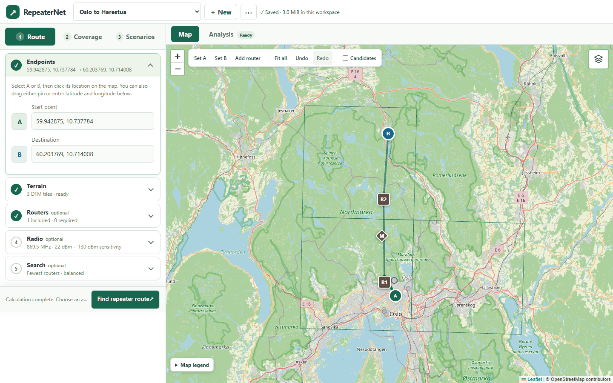

# RepeaterNet

RepeaterNet is a self-hosted, terrain-aware RF mesh planner for Norway. Plan a
connection between two endpoints, include existing MeshCore repeaters, compare
routes and estimate handheld coverage.



RepeaterNet is in pre-release. Route and coverage results are predictions based
on the configured terrain and radio settings. Verify important links in the field.

## Run the executable

Download `repeaternet-windows-x64.zip` from [GitHub releases](https://github.com/fredriknk/repeaternet/releases),
check the ZIP against `SHA256SUMS.txt`, then extract and double-click
`repeaternet.exe`. The dashboard opens at `http://127.0.0.1:8000/`.
The executable embeds the dashboard and runs without Python or a GIS runtime.
Stop it with Ctrl+C.

Use `--no-browser` for headless operation or `--data <directory>` to use a separate
catalog. Run one server per data directory. Keep the same browser profile and
host to reopen your workspace. [Launcher and configuration](rust/README.md#command-line-flags)

## Start with Docker

```sh
docker compose up -d --build
```

Open `http://localhost:8000/`. The amd64 image runs the static Linux executable
as UID and GID 1000. Compose keeps data in the `planner-data` volume and publishes
port 8000 on loopback by default. Set `RF_PLANNER_BIND` to change the host-side
binding and `RF_PLANNER_TOKEN` to require sign-in.
[Deployment settings and HTTPS](rust/README.md#environment-variables)

## Build from source

Install [Rust with rustup](https://rustup.rs/). The workspace pins Rust 1.100.0.
On Windows, install the MSVC C++ Build Tools and a Windows SDK, then run from
the repository root.

```powershell
.\tools\build-rust.ps1
.\rust\target\release\repeaternet.exe
```

On Linux, build with a system linker installed.

```sh
cd rust
cargo build --locked --release -p repeaternet
./target/release/repeaternet
```

## Plan a connection

1. On the map, choose **Set A** or **Set B**, then click the location. In
   **Route** → **Endpoints**, you can also enter coordinates in **Start point**
   and **Destination**.
2. In **Terrain**, select **Estimate Kartverket terrain**, then **Download
   planned terrain**. To use local GeoTIFFs, open **Upload your own terrain
   files** and choose **Add ground terrain**. Surface terrain is optional.
3. In **Routers**, use **Find nearby MeshCore routers** to load existing sites.
   Mark them **Optional**, **Required** or **Excluded**. Use **Place proposed
   router on map** to add a trial site. Set the objective and effort in **Search**.
4. Select **Find repeater route**. If the planner finds missing terrain, review
   and confirm the proposed download before the search starts.
5. Open **Analysis** to compare alternatives, inspect link profiles or download
   results. Open **Map** to see the route in context.
6. In **Coverage**, select **Calculate coverage** to estimate handheld coverage.
   Open **Scenarios** for failure and height comparisons and target assessment.

## Documentation

- [User guide](docs/USER_GUIDE.md) for projects, routes, coverage and results.
- [Application reference](rust/README.md) for configuration and HTTP endpoints.
- [Development guide](docs/DEVELOPMENT.md) for architecture, crate guides and tests.
- [UX design rules](docs/UX_DESIGN_RULES.md) for dashboard changes.
- [Release validation](docs/RELEASE_VALIDATION.md) for executable checks and packaging.
- [Roadmap](docs/ROADMAP.md) for outstanding release and engineering work.
