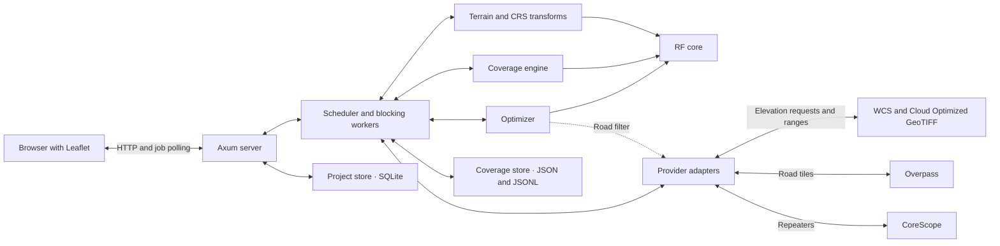

# Development and architecture

RepeaterNet runs as one native `repeaternet` process. It serves an embedded
vanilla-JavaScript and Leaflet dashboard. The built-in data source registry and terrain CRS catalog are embedded too. The executable runs without a frontend
build, Python, GDAL or PROJ. The retired Python implementation is available at
commit `18b7cee`. The [migration inventory](history/RUST_MIGRATION.md) records
the original compatibility contracts.



## Source layout

The Cargo workspace lives under [`rust/`](../rust). Paths in this table are
relative to the repository root.

| Path | Responsibility |
| --- | --- |
| [`rust/crates/web-server/`](../rust/crates/web-server/README.md) | Launcher, axum routes, workspace state, validation, jobs and persistence integration |
| [`rust/crates/web-server/assets/`](../rust/crates/web-server/assets) | Dashboard and Leaflet assets embedded at build time |
| [`rust/crates/web-server/tests/`](../rust/crates/web-server/tests) | Executable integration test and Node dashboard tests |
| [`rust/crates/project-store/`](../rust/crates/project-store/README.md) | SQLite projects, revisions, route snapshots and recovery |
| [`rust/crates/rf-core/`](../rust/crates/rf-core/README.md) | RF sites, radio budgets, profile sampling and propagation math |
| [`rust/crates/terrain/`](../rust/crates/terrain/README.md) | GeoTIFF decoding, CRS transforms, terrain mosaics and corridors |
| [`rust/crates/optimizer/`](../rust/crates/optimizer/README.md) | Candidate generation, graph search, RF certification and scalar cache |
| [`rust/crates/coverage/`](../rust/crates/coverage/README.md) | Area grids, exact-point evaluation, scenarios, comparisons and targets |
| [`rust/crates/coverage-store/`](../rust/crates/coverage-store/README.md) | Coverage manifests, result pages, target reports and identity checks |
| [`rust/crates/exports/`](../rust/crates/exports/README.md) | Route CSV, GeoJSON and HTML, plus coverage JSON, GeoJSON and HTML |
| [`rust/crates/providers/`](../rust/crates/providers/README.md) | Worldwide WCS and COG elevation, Overpass roads and CoreScope adapters |
| [`rust/crates/corescope-capture/`](../rust/crates/corescope-capture/README.md) | Standalone CoreScope RF reception and topology capture to SQLite |
| [`tools/`](../tools) | Windows build, executable verification and release packaging |
| [`.github/workflows/ci.yml`](../.github/workflows/ci.yml) | Windows PR checks and tagged Windows release publishing |

## Process model

Run one server process per data directory. The workspace registry, job
scheduler and scalar RF caches live in that process. By default every browser
shares one catalog, which resolves legacy projects in their original
directories, and the workspace cookie maps each browser profile to its own saved
selection. Each project has a runtime lock shared by all clients using it. With
`--private-sessions` the registry instead serializes state access by workspace
cookie and each browser profile has a private workspace. The access token only
gates sign-in; it no longer decides whether projects are shared.
Handlers capture project and job identity under the relevant lock, run blocking
raster, network and search work on
workers, then recheck identity before publishing. Planner jobs share a
bounded scheduler. Route and coverage evaluation can use additional scoped
worker threads. Terrain uploads use separate admission limits.
[Configuration and limits](../rust/README.md#environment-variables)

### Route search

1. The dashboard saves pending edits and checks terrain readiness. It can
   estimate and queue a corridor terrain download, poll until the terrain
   is ready, then submit the route plan to `POST /api/optimize`.
2. The handler validates the plan and requested project revision, opens route
   terrain, projects site coordinates and checks required ground samples.
   It saves the plan and queues the route job.
3. The optimizer generates candidate sites when enabled, applies terrain and
   exclusion filters, and optionally filters by mapped Overpass roads.
   It screens links, searches topologies and certifies alternatives at the
   final profile resolution using RF core. It publishes certified snapshots
   as they become available.
4. The server persists the terminal native snapshot, summary and run state in
   SQLite. The dashboard polls `/api/state` for job progress and reads
   `/api/result` for alternatives and profiles. On reopening, the server
   restores a saved completed or stopped snapshot if the plan and route
   terrain fingerprints match.

### Named-client mesh search

The JSON plan stored by project-store accepts `mode: "endpoints"` (also the
default when omitted) or `mode: "mesh"`. `clients` contains entries with a
stable `CL-` ID, a name, WGS84 latitude and longitude, and `antenna_height_m`.
A saved draft can contain fewer than two clients. Search and terrain planning
require two distinct client locations. The A/B fields are kept when switching
modes. Each mesh client uses the A radio profile with its own antenna height.

Mesh requests use the standard optimization, terrain readiness, estimate and
download endpoints. The shared projected `MeshArea` uses the convex hull of
the clients and required routers. Candidate generation and terrain planning
buffer it by the configured search width. Terrain downloads also include
buffers around other included routers. Readiness checks sample the search
area and report any terrain gaps separately from missing terrain at sites.

`optimizer::connect_mesh` is the reusable connection step. It grows
node-weighted Steiner subsets across a screened `RoutingGraph`, using
several roots and charging generated routers once per installation. It
explores alternate subsets and prunes optional routers. Per-pair paths
enforce the hop limit and stop expansion at intermediate clients. The step
ranks the subsets it finds by new-router count, weakest link and maximum
pair hop count. It does not guarantee a global minimum. The optimizer
rechecks selected installations at certification resolution and refines
each moved router against every incident link before restoring profiles.

Mesh result payloads add names, connected client and new-router counts, and
`client_pairs` with site IDs, hops and weakest margin for each pair. Alternative
selection updates these alongside the active sites and links. Plan JSON exports
carry a current certified topology when available. Import uses the plan inputs.

### Placement optimization

`POST /api/optimize-placement` accepts `site_ids` (2–32 selected IDs) and optional
`radius_m` (greater than zero, up to 2,000 m). It uses the active project's saved
plan and current alternative. The server resolves which sites can move and
restricts the alternative's links to the selection. Without a current
alternative, the optimizer builds the link set from pairs initially within the
configured range. Route search and placement use the same road access filter
and respect optional `exclusions_wgs84` plan polygons (lists of `[latitude, longitude]` pairs).

The optimizer scans a terrain grid around each router's original position for
up to four rounds. It reevaluates links incident to each trial position at the
final RF sample step. Moves improve the weakest margin first and the total
margin second, and preserve evaluable links. Missing profiles rank below RF
results. The planner scheduler queues the job, `/api/state` exposes an active
`placement_job`, `GET /api/optimize-placement/{id}` returns progress and the
terminal preview, and `POST /api/cancel` accepts its job ID. Placement previews
are held in memory and tied to the project inputs, terrain and route snapshot.
Apply uses the dashboard's existing plan edit, undo and autosave path.

### Live coverage

1. `live_coverage.js` lists the active endpoints or named clients and routers
   on the map and sends one
   `POST /api/live-coverage` per site with its position, height, the handheld
   profile, view, radius and resolution. Radio settings come from the saved
   plan, so the dashboard flushes autosave first.
2. The handler opens route plus supplemental terrain through a process-wide
   tile cache of resampled elevations, then runs a radial sweep from the site.
   Each ray keeps a running horizon and the upper convex hull of the
   curvature-adjusted profile, so every sample's Bullington loss is evaluated
   incrementally with the same arithmetic as the link evaluator.
3. The polar margins are resampled to a Web Mercator raster and returned as a
   compact binary body (`RNLC` header plus one byte per pixel).
4. The dashboard caches rasters per site and input, previews coarsely while a
   marker is dragged and composites best margin, overlap and missing terrain in
   a canvas grid layer.

### Coverage run

1. The dashboard sends coverage settings and the certified route snapshot and
   alternative. It can estimate or preview the grid, or request supplemental
   terrain for the chosen area in the existing route CRS.
2. The handler resolves area, sources and grid, applies optional source-height
   overrides and builds the run identity. The coverage mosaic reads route
   terrain first and supplemental terrain second. The identity includes
   both sets of terrain files, settings, radio and model.
3. The coverage store checks for a compatible complete run. On a miss, a
   planner worker evaluates the grid and commits ordered JSONL chunks with
   progress metadata. The manifest records the committed byte watermark.
   Cancellation leaves committed chunks available for paging. Recovery marks
   unfinished runs interrupted and trims uncommitted native data.
4. The dashboard polls the manifest and pages the stored cells for the map.
   Exports and analyses read the saved grid. Exact-point inspection queues
   a separate evaluation and uses live settings or a compatible saved run.
   [HTTP job and export contracts](../rust/README.md#http-reference)

## Persistence layout

| Path relative to the selected data directory | Contents |
| --- | --- |
| `projects.sqlite3` | Catalog, workspace selection, current and previous plan, route summary and run state, and the native snapshot in `route_results`. SQLite can create WAL and SHM sidecars. |
| `projects.sqlite3.repeaternet-intent` | SQLite journal for staged project-store publication and reconciliation. |
| `<workspace-key>/projects/<directory-token>/` | Project files. Catalog project IDs and directory tokens are separate. Legacy catalog rows can refer to the workspace root. |
| `providers.json` | Server-wide custom sources and disabled built-ins. `RF_PLANNER_PROVIDERS_FILE` overrides this path. |
| `shared-cache/sources/`, `shared-cache/composed/`, `shared-cache/overpass/` | Shared downloads. `RF_PLANNER_CACHE_DIR` overrides the cache root. |

Paths below are relative to a project directory.

| Path | Contents |
| --- | --- |
| `plan.json` | Atomic mirror of the SQLite plan. SQLite is authoritative. |
| `dtm/`, `dom/` | Route ground and surface uploads. |
| `terrain-generations/generation-*/{dtm,dom}/` | Downloaded route terrain. |
| `coverage-terrain-generations/generation-*/{dtm,dom}/` | Downloaded supplemental terrain. |
| `{terrain-generations,coverage-terrain-generations}/generation-*/sources.json` | Source attribution and product metadata published with the terrain tiles. |
| `coverage-job.json`, `coverage-jobs/<job-id>.json` | Latest manifest and prior manifests archived on rollover. |
| `coverage-reused-selection.json` | Optional pointer recording a reused run selected by the server. |
| `coverage-results/<job-id>.jsonl` | Ordered coverage result chunks, one array per line. |
| `coverage-target-reports/<job-id>-<report-id>.json` | Saved target assessments. |
| `.coverage-store.lock` | File lock for cooperating coverage-store readers and writers. |

New projects start with their own directory. Loose files in a workspace root
stay in place. Existing Python catalog rows and compatible historical
coverage artifacts can be read in place. See the
[project store](../rust/crates/project-store/README.md) and
[coverage store](../rust/crates/coverage-store/README.md) for recovery rules.

Terrain generations are staged beside their destination and published with a
rename after all requested products are ready. Upload and removal operations
can create `.terrain-upload-*` and `.terrain-removal-*` staging entries.
The project store uses `.repeaternet-stage-*` and `.repeaternet-owner-*`
entries during journaled publication. Route uploads, clearing or
successful route terrain preparation remove supplemental generations.
Changing the coverage area or selected alternative preserves them. The
supplemental estimate subtracts installed tile footprints by product. Raster
sampling still checks masked and missing pixels.

The [data sources API](design/DATA_SOURCES.md#http-api-web-server) reloads
`providers.json` on estimates and download requests. Each worker retains its
starting registry snapshot. Before queueing, the server compares the
registry fingerprint with the one used to estimate the request. The provider
adapter ranks sources per tile and fills remaining gaps in order. Local terrain
consumers read the resulting GeoTIFF mosaic in one projected CRS.

Shared provider caches sit outside project storage usage. Raw terrain
responses live under `sources/<provider-id>/<fetch-definition-hash>/`.
COG byte chunks are 256 KiB, with object metadata, missing-tile markers and
a small whole-object fallback for servers that ignore ranges. Composed
projected tiles and their provider reports are keyed by grid, product and
ordered provider definitions under `composed/`. The Overpass grid uses
0.1° latitude by 0.2° longitude cells. Provider downloads can survive a
cancelled job and be reused. Shared caches have no automatic retention policy.
Stop the server before backing up the full data directory or removing the
shared cache.

## Dashboard assets

[`index.html`](../rust/crates/web-server/assets/dashboard/index.html) loads
Leaflet CSS, then `style.css` (base), `meshcore.css`, `coverage.css`,
`workspace.css` (shell, panels and Analysis) and `map.css`. After Leaflet,
the deferred classic scripts load in order
`main_view_navigation.js`, `coverage_raster.js`, `live_coverage.js`,
`site_selection.js`, `mesh_mode.js`, `placement.js`, `app.js` and `coverage_inspection.js`.

`siteSelection.ids` returns a snapshot of the selected site IDs in the current
project. Call `toggle(id)`, `replace(ids)` or `clear()` on `siteSelection` to
change membership. `siteSelection.subscribe(listener)` receives snapshots and
returns an unsubscribe function. Use `findMapSite(id)` to resolve an ID when
handling an action.

Use `siteSelection.registerAction({id, label, isAvailable, run})` to add an action
to the map and Route sidebar selection panels. The optional
`isAvailable(sites)` predicate receives the resolved sites. The UI passes a new
ID snapshot to `run(ids)` and respects the edit lock. The registration returns
a function that removes the action. Plan edits from these actions still use the
shared history, invalidation and coverage refresh chain.

Put new styles in the layer that owns the feature.

Register a new asset and its content type in
[`src/assets.rs`](../rust/crates/web-server/src/assets.rs) and reference it
from the page as needed. Rebuild the executable to see embedded asset changes.
Follow the [UX design rules](UX_DESIGN_RULES.md) and use the shared test data
directory (`%LOCALAPPDATA%\RepeaterNet\test-data`) for browser checks, so cached
terrain tiles are reused between runs.

## Verification

Use the [pinned toolchain](../rust/rust-toolchain.toml). Windows builds use the
MSVC C++ Build Tools and a Windows SDK. From `rust/` run:

```sh
cargo fmt --all --check
cargo clippy --workspace --all-targets --locked -- -D warnings
cargo test --workspace --locked
```

From the repository root run:

```sh
node --test rust/crates/web-server/tests/js/
git diff --check
```

Windows CI also reruns terrain and coverage tests with
`RF_PLANNER_TERRAIN_CACHE_MB=0`. The Rust suites include RF and terrain
fixtures, optimizer certification, storage recovery and HTTP workflows.
The executable integration test launches on loopback with temporary data,
uploads a synthetic GeoTIFF, searches, calculates coverage, verifies paging,
inspection and exports, then reopens the project after restart. Python-derived
fixtures are frozen oracles. Their generators remain at `18b7cee`.

Node uses the built-in test runner. Tests exercise the navigation helper and
evaluate slices of the classic dashboard scripts with stubbed browser, map
and network calls. They cover navigation event handling, autosave and
inspection races, terrain actions, and road overlays. When moving a function,
check the source boundaries used by the tests. Use a real browser to verify
layout, focus and downloads after UI changes.

Before release, run the [release workflow](RELEASE_VALIDATION.md) on the exact
candidate. For container changes, rebuild and check the supplied Compose
service with a disposable volume. Track open acceptance work in the
[roadmap](ROADMAP.md).

## Documentation screenshots

Before opening a PR for a major dashboard change, regenerate the user-guide
images with the [manual Playwright capture tool](../tools/docs-screenshots/README.md).

## Benchmarks

The [coverage cache benchmark](../rust/crates/coverage/README.md#cache-benchmark)
measures cold and warm coverage on synthetic terrain or a local raster.
Record the host, revision, settings, fixture checksum and repetitions. Cold
runs begin with empty application caches and use the ordinary OS file cache.
The [terrain fixture manifest](REAL_TERRAIN_FIXTURE.md) lists optional real
terrain uses. [Recorded Python measurements](benchmarks) are dated baselines.

Current instructions live in the application reference, the user guide and
this guide. [Historical records](history/README.md) preserve dated plans and
evidence. When changing the engine, preserve workspace isolation, path
containment, stale-result guards and model fingerprints.
