# RepeaterNet user guide

RepeaterNet plans terrain-aware radio links between two locations and estimates
where a handheld could use the resulting mesh. **1 Route** sets up the link,
**2 Coverage** shows live handheld coverage around every site, and **3 Scenarios** tests changes and
assesses places you care about. Use **Map** to edit the plan and **Analysis** to
read the result. The examples use a roughly 29 km route across Nordmarka, from
Oslo to Harestua. A certified route meets the configured model checks. Verify
critical links in the field before choosing installation sites.

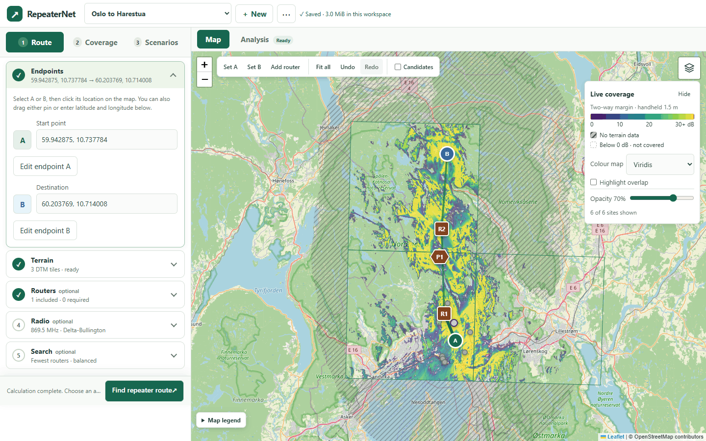

## Contents

- [Installation and launch](#installation-and-launch)
- [Projects and saving](#projects-and-saving)
- [Route setup](#route-setup)
- [Editing on the map](#editing-on-the-map)
- [Running a search and managing jobs](#running-a-search-and-managing-jobs)
- [Reading Analysis](#reading-analysis)
- [Route exports](#route-exports)
- [Coverage](#coverage)
- [Location inspection](#location-inspection)
- [Scenarios and targets](#scenarios-and-targets)
- [Coverage exports and reports](#coverage-exports-and-reports)
- [Terrain and coordinates](#terrain-and-coordinates)
- [Data sources](#data-sources)
- [Road filter](#road-filter)
- [Keyboard shortcuts](#keyboard-shortcuts)
- [Mobile layout](#mobile-layout)
- [Interpreting RF results](#interpreting-rf-results)
- [Limitations](#limitations)
- [Troubleshooting](#troubleshooting)

## Installation and launch

Follow the [installation and launch instructions](../README.md) for your
platform. By default the server listens at **http://127.0.0.1:8000/**. If the
browser does not open, use the address printed by the server. If the operator
configured an access token, enter it in **Access token** and choose **Sign in**.
On your own device, select **Keep me signed in for 30 days** to stay signed in
when you reopen the browser. The browser must keep cookies for the same server
address. The browser's workspace cookie identifies your projects separately.

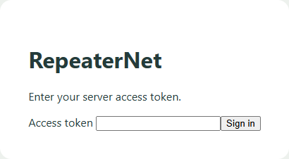

## Projects and saving

Choose a project in the top bar or use **＋ New**, give it a **Project name**
and choose **Create**. A new project starts with example coordinates near Oslo.
Plan edits save automatically. The top bar shows saving or saved status, with
workspace storage usage when available. If saving fails, correct any invalid
fields or restore the connection, then choose **Retry save**.


Open **⋯** for project actions.

| Control | What it does |
| --- | --- |
| **Rename…** | Changes the current project's display name. |
| **Duplicate** | Opens a copy with the current saved plan and terrain. Calculations can be run separately in the copy. |
| **Recover previous save** | Restores the previous saved plan revision and makes the current revision the recovery copy. This appears when a previous revision exists. |
| **Export plan file** | Downloads a portable `route.webplan.json` with settings, sites, policies and targets. Terrain and computed results are separate. |
| **Data sources…** | Manage the terrain providers and map layers available to all projects on this server. |
| **Import plan file…** | Opens the plan JSON and autosaves its settings and sites in the current project. Import into a new project to keep both plans. Load matching terrain as needed. |
| **Archive** | Removes the project from the active list and keeps its saved data. The dashboard switches to another project or creates a replacement. |
| **Archived projects** → **Restore** | Returns an archived project to the active list and opens it. |
| **Delete permanently…** | Deletes the selected project's stored data after confirmation. |
| **Clear saved RF calculations** | Clears cached link calculations for this workspace. Later RF searches may have more work to do. Terrain providers and Overpass downloads have their own shared caches. |

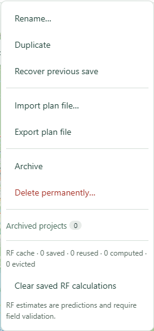


Projects and saved coverage runs live on the server. The browser's workspace
cookie lets it reopen the same project list. Another browser profile or a cleared
cookie can open a different workspace. The dashboard has no user accounts or
cross-browser project-sharing controls. A compact route summary survives a server
restart. Rerun the saved plan to rebuild full route profiles and restore the
certified route for current analysis. Saved coverage runs can be opened separately.

## Route setup

In **1 Route**, open each step by its heading. The collapsed summaries show what
you set. The readiness card offers **Review endpoints**, **Open terrain setup**
or **Review terrain gaps** when it needs your attention. For a first search,
**Endpoints** and ground **Terrain** are enough to get started.

### Endpoints

Enter WGS84 latitude and longitude, separated by a comma, in **Start point** (A)
and **Destination** (B). You can also use **A** or **B** in the step, **Set A**
or **Set B** on the map, or drag either pin. Check where both pins landed.


### Terrain

**Terrain source** defaults to **Automatic · best available**. The status below
the selector describes which providers cover the route and which may fill gaps.
Choose a specific provider to prefer it, then use **Fill gaps from other
sources** to control whether the planner can use other providers as needed.

Choose **Estimate terrain download**. Review the planned tile count, effective
resolution, disk usage, free space, cache hits and the list of sources with
their attributions and warnings. Choose **Download planned terrain** to review
and confirm the download. If you start with **Find repeater route** and ground
tiles are missing, the combined estimate offers **Download and find route**.

Under **Download options**, **Requested resolution · m** defaults to 10 m.
**Coarsen automatically to stay within the pixel budget** allows larger pixels
when needed. **Also download surface terrain** is enabled in a new project.
When surface elevation is unavailable, the Terrain step explains why and the
estimate includes ground tiles only. Surface tiles increase disk usage when
available.

Expand **Upload your own terrain files** to use local GeoTIFFs. **＋ Add ground
terrain** accepts bare-earth DTM tiles. **＋ Add surface terrain** accepts optional
DOM tiles for mapped surface obstacles. Each tile can be up to 512 MiB. Use
**Clear** beside the corresponding set to remove its workspace copy. Check the
confirmation for any additional coverage terrain that will also be cleared.
See [terrain and coordinates](#terrain-and-coordinates) for the file and map details.

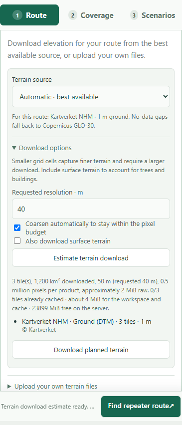


### Routers

Use **Find nearby MeshCore routers** to refresh the CoreScope catalog for the
current corridor. New feed entries start **Excluded**. Refreshing preserves saved
policies and marks entries missing from the latest feed as stale. The list shows
activity, last heard and distance from the route where available. Missing antenna
data uses your repeater assumptions. Feed activity is evidence of reported use.
The RF search still evaluates each link. **Help: existing and proposed routers**
explains what the feed and saved entries mean.

- Narrow the list with **Find by name or ID**, **Activity** or **Search policy**.
  **Activity** offers **Any activity**, **Relay active**, **Heard within 7 days**
  and **Active and heard within 7 days**. **Search policy** offers **Any policy**,
  **Optional**, **Required** and **Excluded**.
- Set a policy in each row. **Optional** allows the site to compete, **Required**
  includes it in the search constraints, and **Excluded** takes it out of the
  search while keeping the entry. **Show** centers the map on the router.
- **Mark … matches optional** and **Exclude … included matches** act on the
  matching set across the whole filtered list, including rows below the scroll.
  The count next to the buttons describes the scope.

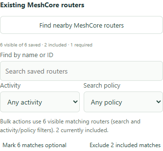

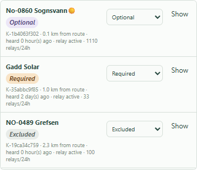

To record observed MeshCore links over time, run the separate CoreScope
capture utility. It saves receptions in SQLite and shows them on a local live
map. Each CoreScope instance has its own capture file and a dashboard labelled
with its host. See the [CoreScope capture guide](../rust/crates/corescope-capture/README.md).

To collect Meshtastic RF measurements or view measured links together, use
the separate `meshtastic-capture` utility. Its **Measured links** viewer
opens at `http://127.0.0.1:8795/` and reads the capture databases while
collection runs. Filter the map by network, source, band, preset, evidence,
time window or position precision. Suspect links (zero SNR, old firmware or
endpoints over 300 km apart, usually MQTT-bridged neighbours) are hidden by
default; clear **Hide suspect links** to show them. See the [Meshtastic capture and viewer guide](../rust/crates/meshtastic-capture/README.md).
Import worldwide 400–406 MHz radiosonde measurements with [sondehub-import](../rust/crates/sondehub-import/README.md), then select **Radiosonde** and **Last week** in the measured-links viewer.

For a site you want to try, use **Place proposed router on map** or expand
**Add a proposed router by coordinates**. Enter **Latitude**, **Longitude** and
**Antenna height · m**, then choose **Add router at coordinates**. A site placed
on the map starts at the configured repeater height. The coordinate form starts
at 10 m and accepts 0.1–1,000 m. Proposed sites start **Optional** and are named
**P1**, **P2** and so on. The same name labels the site's hexagonal marker on the
map, its row and its hops in **Analysis**. Use the site row or marker to change
**Name**, **Antenna height · m** or **Use in search**. To move
it from the list, edit **Latitude** and **Longitude**, then choose **Apply
coordinates**. **Show on map** centers the map on the site. **Remove** removes
it from the plan. **Help: proposed routers** explains how to pin a route site.

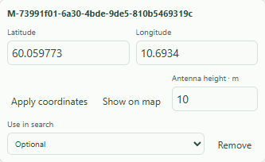

### Radio

Set **Frequency · MHz** for your radios. Under **Transmitter and receiver
specifications**, enter **TX power · dBm**, **Sensitivity · dBm** and **Fade
margin · dB**. Choose **RF propagation + diffraction** or **Strict line of sight
+ Fresnel** in **Link validation**. Under **Antenna & propagation assumptions**,
set **Height AGL · m**, **Gain · dBi** and **Feed loss · dB** for **Endpoint A**,
**Endpoint B** and **Repeaters**. AGL is height above ground level. Each role
also has a **Terminal clutter** setting. The default is **None**. Choose
**Nearby trees and buildings (P.2108 from DOM)** to use local surface height
around the site. On a proposed or MeshCore router, use **Terminal clutter**
in its sidebar row or map popup to override the repeater default for that site.

Under **Propagation model**, the default **Diffraction model** is
**Delta-Bullington**. You can choose **Bullington** (the previous default) or
**Deygout 3-edge** for route search. Live coverage uses Delta-Bullington when
Deygout is selected. **Diffraction surface** defaults to **Ground (DTM)**.
Using **Surface with trees and buildings (DOM)** can substantially overestimate
diffraction loss. **Model correction · dB** adds 3 dB of loss by default and
accepts 0–20 dB. **Earth k-factor**, **Fresnel clearance fraction · 0–1** and
**Miscellaneous loss · dB** are in the same assumptions group.

The starter profile uses 869.5 MHz, 22 dBm transmit power, −130 dBm sensitivity,
a 10 dB fade margin and 0 dB miscellaneous loss. All three antenna defaults are
3 m AGL, 2.15 dBi gain and 1 dB feed loss. Default validation uses propagation
and diffraction, k = 1.0 and 60% Fresnel clearance. See
[interpreting RF results](#interpreting-rf-results) for how these settings are used.


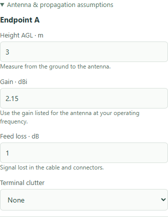

### Search

**Which sites can the route use?** offers **Use existing + proposed**, **Existing
only** and **Proposed only**. The default allows both kinds. Choose a **Route
objective** for how feasible alternatives are ranked.

| Objective | What it prioritizes |
| --- | --- |
| **Fewest total routers** | Starts with the smallest total router count and prefers reuse when margins are comparable. This is the default. |
| **Fewest new installations** | Use of existing infrastructure to reduce the number of new sites. |
| **Minimum infrastructure cost** | A planning proxy based on installations and mast heights. |
| **Maximum reliability** | Independent paths, then RF quality among equally redundant options. It can favor extra routers. |

The number of candidate sites follows the route length, and so does the
search time. There is no fixed limit. Candidate sites are dense within half the
route length of the A–B line, at least 5 km and at most the corridor
half-width. Between that band and the corridor half-width, only the highest
point of each 4 km square is kept, so a short route can still use a dominant
summit some distance away. With the default 15 km corridor, a 5 km route gets
about 300 candidate sites and a 50 km route about 2,000.

**Search effort** sets how densely candidate sites are placed near the route:
**Quick · fewer candidate sites** keeps 2 per 2 km square, **Balanced ·
standard density** (the default) keeps 3, and **Thorough · densest, slowest**
keeps 6. Doubling the density roughly quadruples the search time, so Thorough
can take a few minutes on routes over 100 km. At every level the search
checks every plausible link between candidate sites, not only nearby ones, so
long hops between distant hilltops are found. It also places extra candidates
around A and B, where the first and last hops are usually hardest. The
Analysis diagnostics report how many candidate sites were generated.

The search then returns the route with the strongest weakest hop for each
router count. A route with more routers is listed only when it is stronger than
every route with fewer. Hops with clear line of sight and Fresnel clearance are
preferred over obstructed hops that rely on diffraction. Each planned hop is
checked again at the final terrain sample step before it is accepted. Finally,
each generated router is moved within the refinement radius when a nearby
position makes its hops stronger. The Analysis diagnostics say how many links
were screened and how many routers were moved.

**Required** routers are via points: the route passes through every required
router, in the order that gives the strongest route, and never uses a site
twice. Smaller searches can miss stronger alternatives. **Help: search effort**
summarizes the trade-off. **Only suggest sites near roads** adds the optional
[road filter](#road-filter).

| Search limit | Default and scope |
| --- | --- |
| **Maximum new routers** | 6 sites placed by the search. Existing MeshCore routers, proposed P routers and required routers use none of this budget. Set it to 0 to use only sites already in the plan. |
| **Maximum hops** | 7 links per endpoint-to-endpoint path, including backup paths. A direct route uses 1 hop and each intermediate router adds 1 hop. |

When routes have the same clearance class and their weakest links fall in the
same 1 dB margin band, **Fewest total routers** can prefer the route that needs
fewer new sites.

Open **Advanced search limits** to adjust the search area, candidate grid or
final terrain sampling.

| Control | Default and effect |
| --- | --- |
| **Corridor half-width · m (each side and around endpoints)** | 15,000 m. The 30 km wide, square-ended band extends 15 km past A and B. It is the outer limit for generated candidates and guides route terrain downloads and the nearby MeshCore lookup. Candidates are dense only within half the route length of the line (at least 5 km). |
| **Candidate grid spacing · m** | 1,000 m between candidate grid points. Smaller spacing explores more possible locations. |
| **Maximum hop length · m (blank = auto)** | 50,000 m. Clearing the value removes the explicit distance cap. |
| **Refinement radius · m** and **Refinement step · m** | After the route is found, each generated router may move up to 250 m to strengthen its hops. Positions are sampled every 50 m, or at the terrain resolution if that is coarser. Your own proposed and existing routers never move. |
| **Final terrain sample step · m** | The default and maximum are 10 m between samples on final route links. The earlier screening stages default to 200 m and 50 m. |

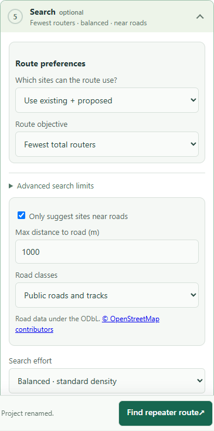


## Editing on the map

Use **Set A**, **Set B** or **Add router**, then click the map. The mode stays
visible in the toolbar while it expects a click. **Cancel** or Esc returns to
browsing. Right-click a position for **Set start (A) here**, **Set destination
(B) here**, **Add proposed router here** or **Copy coordinates**. Copied
coordinates use latitude, longitude to six decimals.


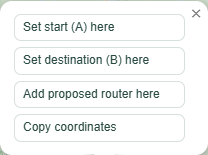

- Drag either endpoint or a proposed router to move it. Open a proposed
  router's popup to change its name, antenna height or policy, or use
  **Remove**.
- Open a MeshCore router marker to read its ID and activity and choose **Excluded**,
  **Optional** or **Required**.
- Select an endpoint or router on the primary route to see its adjacent hops.
  Each hop shows distance, usable margin, line of sight, minimum Fresnel
  clearance and an elevation profile. Press **Enter** or **Space** on a focused
  marker to open the inspector, and **Esc** to close it.
- Drag an endpoint or proposed route site to preview the adjacent hops and
  their colours on the map as you move it. Dropping a proposed route site pins
  it as a new **Required** proposed router. The previous route is marked stale,
  its site markers turn grey and dashed, and the inspector keeps the preview
  for the dropped location. Use **Undo** to revert the move, or run a new search
  to validate the edited route.
- From the inspector, open **Site details** for a router's height, type, policy
  and distance to a mapped road when available. Select a link there to open its
  profile in **Analysis**. **Edit proposed router** or **Edit MeshCore router**,
  when shown, opens the router's settings.
- **Fit all** frames the plan sites and current route. **Undo** and **Redo** step
  through recent plan edits. **Candidates** shows generated sites from the search.
  **Roads near repeaters** toggles the selected alternative's nearby road geometry
  when available.
- Use **+** and **−** to zoom. In the layer control, choose **OpenStreetMap** or
  **Kartverket topo**, and other enabled maps. Regional layers display
  **(outside view)** when the map is outside their coverage. Your selected
  basemap stays in place as you pan. Toggle **Live coverage**, **Terrain coverage**, **Predicted mesh coverage** (a saved run),
  **Coverage analysis area**, **Coverage difference** or **Coverage targets** as
  needed. **Map legend** explains the route lines and marker shapes.

Each site has one marker, and its shape says what kind of site it is:

| Marker | Meaning |
| --- | --- |
| Green **A** and blue **B** circles | Endpoints |
| Dark hexagon with a name (**P1**) | A proposed router you placed |
| Brown square (**R1**, **R2**…) | A new site the search found |
| Round purple dot | A MeshCore router. Light purple means **Optional**, dark purple means **Required**, a small grey dot means **Excluded** |
| Purple pill with a name | A MeshCore router used by the route |
| Small dark pin badge | The router is **Required** in every route |
| Grey dashed marker | A site in a stale route |

When a route is current, the route marker replaces the router's own marker,
so a proposed router in the route keeps its name and pin badge instead of
appearing twice. When the route goes stale, the routers' own markers return.


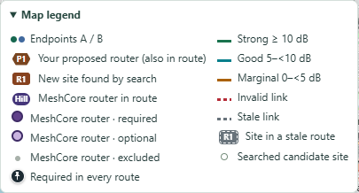


## Running a search and managing jobs

Choose **Find repeater route**. If ground terrain is ready, the search starts
after checking the plan. The engine generates and screens candidates, searches
for routes, and validates selected links at the final sampling step. A required
site needs valid ground elevation. If terrain is missing, review the readiness
message and the [terrain options](#terrain).

The job card shows the phase, elapsed time and progress when available. While it
runs, the inputs for that calculation are locked. **Cancel optimization** stops
the search. Use **Stop and keep this route** once a certified result is available
to retain the best result found so far. Its independent-path count can fall
short of the goal and the result records that the search stopped early.
**Cancel terrain preparation** stops a route terrain job and preserves previously
installed terrain. **Reconnect to job** resumes status checks if the connection
drops. When offered, **View results** opens **Analysis**. Use **Dismiss** (×) to
close the finished notice.


Edits to endpoints, radio, terrain, sites or search settings can make the route
stale. The **Analysis** badge and grey verdict mark the result as stale, and the
old link lines turn grey and dashed. Use **Undo** to return to the certified
inputs, or run **Find repeater route** again to validate the new inputs and
restore route export. Recalculate coverage for a changed route.

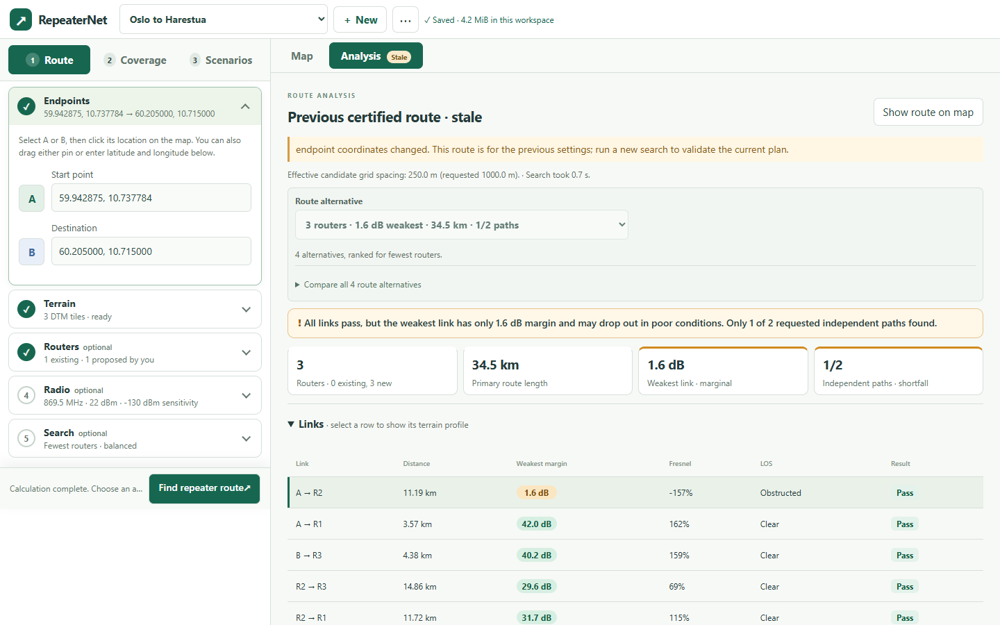

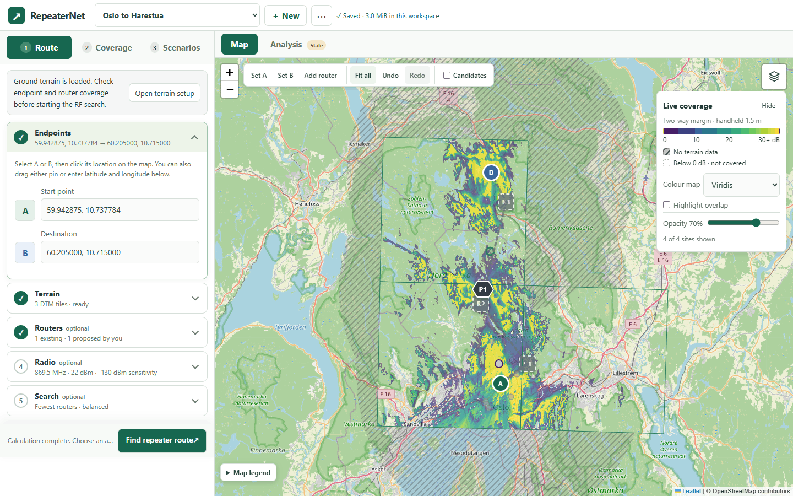

## Reading Analysis

Read the verdict and key figures first. The tiles show router count, primary path
length, weakest link and independent paths. Under **Route alternative**, choose
a different certified solution or open **Compare all … route alternatives** and
select a row. The engine returns feasible alternatives for exact router counts
within the search. Switching alternatives reuses evaluated results and updates
the map. **Show route on map** takes you to the current route.


The comparison shows existing and proposed counts, primary length, weakest
margin across the network, weakest margin on the primary path, LOS-blocked hops
and achieved versus requested independent paths. Independent paths share no
intermediate router. A backup with a small margin can be the network bottleneck
even when the primary route has margin to spare. The default path target is two.

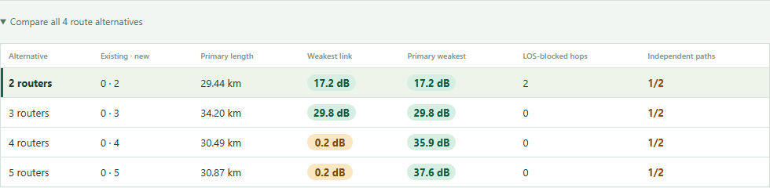

In **Links**, select a row or use the link picker above the chart. The table shows
**Distance**, **Weakest margin**, **Fresnel**, **LOS** and **Result**. The chart
shows ground with curvature, the surface when available, line of sight and the
required Fresnel boundary. Read the profile summary for the limiting points.
Expand **Forward and reverse link budget** for directional power, path loss,
received level, sensitivity and usable margin. **Detailed radio budget and
assumptions** shows the individual terms and model settings.


## Route exports

Use **CSV ↓**, **GeoJSON ↓** or **HTML report ↓** in **Analysis** to export the
selected certified route. CSV provides tabular results and GeoJSON provides map
features. Open the downloaded HTML file directly in a browser, even offline.
It contains an interactive map of the route, nearby roads when available, site
details and terrain profiles. Expand **Directional link budget** below a chart
to see the budget for that hop. Printing includes the budgets automatically.
Route exports include the diffraction model for each hop and the model
correction, terminal clutter and terrain sampling allowance in each direction.


The report includes a snapshot of the live coverage layer when it is visible
and at least one source has finished calculating. The legend shows how many
sources were included. Wait for the enabled sources to finish before exporting
to capture them all. The report also includes the latest completed saved run
when it matches the route, terrain and settings and has no unresolved or
unevaluated cells. Saved coverage counts use the full grid. Use **Map layer**
in the report to switch between the available coverage previews or hide them.
For a specific saved run or historical coverage, use
[coverage exports](#coverage-exports-and-reports).

## Coverage

Coverage is live. As soon as an endpoint or router is on the map, its handheld
coverage is drawn around it. There is no separate calculation step and no
certified route is needed. Each site gets its own coverage map, and the map shows
the strongest usable margin from any of them. **Help: live coverage** in
**2 Coverage** summarises the model. These are predictions from terrain and the
radio settings, not measurements.

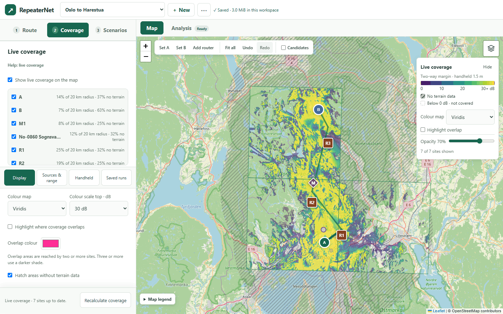

### Moving sites

Drag an endpoint, a proposed router or a route repeater and its coverage follows
the marker: a coarse preview is recalculated while you drag, and a detailed map
replaces it when you let go. Editing coordinates, antenna heights, router
policies or radio settings in the sidebar recalculates the affected sites the
same way. Other sites keep their maps, so only the site you changed is redrawn.

The live model defaults to calibrated Delta-Bullington diffraction over ground
terrain. It includes free-space loss, Earth curvature, model correction, any
terminal clutter enabled for the site, and a sampling allowance for the selected
detail level. The live status reports the fallback to Delta-Bullington when
Deygout is selected for route search. In **Strict LOS** validation mode, places
without line of sight are shown as uncovered. Fresnel clearance is evaluated
for route links.

### Which sites are shown

**2 Coverage** lists every site with coverage on the map, with the share of its
radius that is covered. Clear a site's checkbox to hide its coverage without
changing the plan. **Show live coverage on the map** turns the whole layer off;
the **Live coverage** entry in the map layers control does the same.

In **Sources & range**, **Show coverage for** chooses the kinds of site:

- **Endpoints A and B**, using the endpoint antenna heights from **Radio**.
- **Proposed routers** that you placed.
- **Routers in the selected route**. These follow the selected alternative and
  are hidden while the route is stale.
- **Existing routers included in the search** (policy **Optional** or
  **Required**). Excluded routers have no coverage.

All four are on by default. Sites at the same position are shown once.

### Range, detail and handheld

- **Coverage view** chooses **Two-way margin** (both directions must work, the
  default), **Router → handheld** or **Handheld → router**.
- **Radius · km** limits how far from each site coverage is calculated
  (1–80 km, default 20 km).
- **Detail** sets the map resolution: **Fine · 15 m**, **Standard · 30 m**
  (default) or **Coarse · 60 m**. Finer detail and larger radii take longer.
- **Handheld** sets the client radio: **Height AGL · m**, **Transmit power ·
  dBm**, **Antenna gain · dBi**, **Feed loss · dB**, **Sensitivity · dBm** and
  **Other losses · dB**. The example client uses 1.5 m AGL, 20 dBm, 2.15 dBi,
  −130 dBm sensitivity and no losses. It is separate from the route's radio
  assumptions.

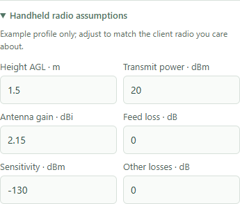

Display choices and range settings are remembered by your browser. Handheld
assumptions are saved with the project.

### Reading the map

Colour shows the best usable margin, after the fade margin, from any visible
site. Areas below 0 dB are left clear so the basemap shows through, and the
weakest few dB fade in so the edge of coverage stays readable. The **Live
coverage** legend on the map shows the colour scale in dB, the view and handheld
height, and how many sites are shown. Use **Hide** to collapse it.

- **Colour map** (in the legend and in **Display**) offers **Viridis** (default),
  **Plasma**, **Turbo (rainbow)**, **Cividis (colour-blind safe)**, **Magma** and
  **Margin bands (orange → green)**, which uses the shared 0, 5 and 10 dB bands.
- **Colour scale top · dB** sets the margin that gets the top colour (20, 30,
  40 or 60 dB).
- **Highlight where coverage overlaps** paints places reached by two or more
  sites in a single **Overlap colour** (pink by default), with a darker shade for
  three or more. The legend names both shades.
- **Hatch areas without terrain data** marks places where no terrain is
  installed. Turn it off to leave them clear.
- **Opacity** in the legend fades the whole layer.

Hover over the map to see which sites reach that point and their margins, for
example "2 sites overlap · R1 · 12.3 dB · A · 4.1 dB".

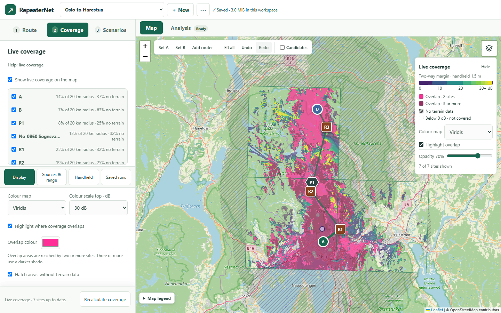

### Terrain for coverage

Coverage uses route terrain first, then supplemental coverage terrain. If a
project has no terrain yet, **2 Coverage** says so and **Open terrain setup**
takes you to **Terrain** in **1 Route**. When part of a site's radius has no
terrain, the site list reports the share and **Download terrain for coverage
area** appears in **Sources & range**. Review the missing area, tile count,
resolution, size and cache reuse, then confirm. The download covers every
shown site's radius. Use **Cancel coverage terrain download** or **Reconnect to
terrain download** as needed. Coverage updates by itself when the tiles are
ready.

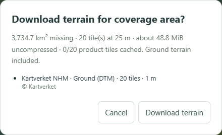

A coverage download preserves the certified route and its original terrain.
Supplemental tiles stay installed when sites or the route alternative change.
Clearing, uploading or preparing route terrain resets the supplemental set.
No-data pixels in the source data still show as hatched.

**Recalculate coverage** in the action bar discards the cached coverage maps and
calculates every site again.

### Saved runs

Failure scenarios, targets, exact-point inspection and coverage reports work on
saved runs: fixed-grid snapshots of a certified route. Open **Saved runs** in
**2 Coverage**. If it asks for a route, **Open route setup** takes you back to
the prerequisite.

Open **Saved run area, sources and calculation** to set up a run:

- **Area** is **Around the selected route** (the route search corridor plus the
  mesh buffer), **Area visible on the map**, or **Draw a custom boundary**
  (use **Draw area on map**, click at least three vertices and choose **Finish
  polygon**; Esc or **Cancel** leaves drawing and **Clear drawn area** removes
  the boundary).
- **Advanced sampling and limits** sets **Cell spacing · m** (default 1,000 m),
  **Mesh buffer · m** (default 5,000 m), **Profile step · m** (default 200 m) and
  **Maximum profile samples** (default 4,096). A profile over the sample cap
  stays unresolved.
- **Include endpoints as sources** and **Router sources** choose the sources.
  Turn endpoints on for a direct route without repeaters.
- **Calculate saved run** shows the work estimate (a 4,096-cell budget by
  default, with hard limits of 16,384 cells, 64 sources and 250,000 cell/source
  evaluations). Confirm to start. **Cancel coverage** stops the job and can keep
  partial cells. **Reconnect to coverage run** resumes after a lost connection.
- **Quick approximate preview** evaluates at most 256 cells and cannot be saved.


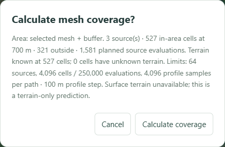

**Analysis context** identifies the selected mesh and client assumptions. Select
a **Saved coverage run** for inspection, targets and exports. **Show saved run on
map** loads its cells without new RF work and hides the live layer while it is
shown; turn **Live coverage** back on to return. **Saved run view** chooses how
a saved run is drawn (two-way, either direction, overlapping routers or best
serving router). The run label includes the time, grid, height overrides and
state. An identical completed run is reused when route, terrain, sources, grid,
radio and model match. A stored result is limited to 100 MiB.


## Location inspection

For a saved run, select it in **Saved runs** and choose **Show saved run on map** first.
Choose **Inspect a map location**, then click the location. You can also inspect
with the current route and coverage settings before saving a run. The exact
point is evaluated using the relevant client assumptions and source heights.
A grid cell nearby represents a different sample.

**Analysis** opens the inspection result. Read the best source, distance,
directional margins, two-way status and mesh component. The details list the
other candidate links and their rejection reasons. Open **Profile legend** to
interpret the terrain and Fresnel chart. The result states when the location is
outside the requested area, terrain is missing or the sample limit prevented an
evaluation. **Show location on map** returns to the marker. **Stop inspecting
locations** or **Cancel** exits inspection mode.


## Scenarios and targets

Use **3 Scenarios** to ask what changes on a calculated network. Saved runs are
snapshots. **Open saved runs** takes you to **2 Coverage** → **Saved runs** if a run is needed.

### Router failure

Open **Router failure scenario**. In **2 Coverage** → **Saved runs**, select a
completed, current run with a repeater source. Back in **3 Scenarios**, pick a
**Reference router**, check one or more **Disable …** boxes and choose
**Analyze failures**. The result reports surviving components and cells that
lost local access or a connection to the reference. A handheld can still
reach a surviving router in a disconnected component. Keep the reference
enabled to measure connectivity to that router. The boxes stay checked after
analysis for the selected run. **Reset scenario** clears the failure selection.
Analyze again to see the baseline.


### Antenna heights and run comparison

Open **Antenna heights & run comparison**. Enter trial heights for the selected
route's repeater sources or choose **Set all to 3 m**, **Set all to 6 m** or
**Set all to 10 m**. Height scenarios accept 0.1–500 m AGL. Change at least one
height, then choose **Calculate height scenario** and approve the coverage
estimate. The run is saved separately. Affected certified backbone links are
revalidated at the trial heights. The scenario uses the existing mesh graph.


Use **Baseline run**, **Scenario run** and a shared **Reference router**.
The dashboard explains incompatible selections. Compare completed runs using
compatible project, terrain, model, radio, client and grid assumptions. Choose
**Compare runs on map** to see **Coverage difference** for reference-connected
coverage. The summary also reports local gains and losses, retained coverage,
unknown cells and unresolved profiles. The map legend labels both displayed
layers and its **Opacity** slider adjusts them together. Use the map layers
control to show either layer on its own.

**Apply heights to plan · undo available** saves the trial heights as plan edits.
Edited proposed sites become **Required**. Run a new route search and calculate
coverage again after applying. Use **Undo** if needed.


### Point, area and road targets

Open **Assess places, areas & roads**. Use **Place a point target on map**,
click the location, enter a name in **Name point target** and choose **Add
target**. Or expand **Add a point by coordinates** and enter **Latitude**,
**Longitude** and **Target name**, then select **Add target at coordinates**.

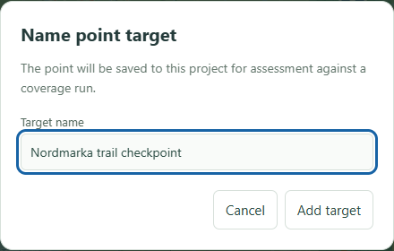

Use **＋ Import GeoJSON targets** for a WGS84 GeoJSON FeatureCollection of
points, lines and polygons, up to 5 MiB. Use longitude, latitude order. Imported
features can include a name, minimum margin and a reference router ID in
`properties`. The fields are `name`, `minimum_margin_db` and `reference_id`.
The default minimum margin is 0 dB. Set **Road sample spacing · m** for
imported lines. It defaults to 100 m and accepts 25–5,000 m.

In the list, use **Focus** to locate a target or **Remove** to delete it.
Point targets also offer **Edit**. Change **Name** or **Minimum margin · dB**
(−100 to 100 dB) and choose **Save target** or **Cancel**. An edit clears old
assessments for the changed target set.

Select a completed, current run in **Saved runs**, then choose **Assess targets
against selected run**. Points and roads use exact-position path calculations.
Areas use conservative saved-grid evaluation. An unknown, out-of-area or
unresolved sample cannot establish a pass, and areas with too few representative
cells can need finer sampling. Use **Focus target** to see an assessed target.


To compare target outcomes, assess the same targets on two compatible saved
runs. Open **Compare target outcomes across runs**, choose a **Baseline target
report** and **Scenario target report**, then choose **Compare target reports**.
Each row shows the change and the two outcomes.


## Coverage exports and reports

In **2 Coverage** → **Saved runs**, select the **Saved coverage run** and open
**Export & print report**. The selected run is used even if a different run
is displayed on the map. Review the export context before downloading.

- **Download GeoJSON cells & targets** includes spatial cell and target
  geometry for mapping.
- **Download JSON results** includes the saved grid and run metadata.
- **Download printable HTML report** includes an offline SVG map and the
  run's RF, terrain and grid assumptions. Open the downloaded file in a
  browser to print it.
- **Optional saved target report** can include assessed targets. **Optional
  comparison run** and **Reference router for comparison** add a compatible
  comparison to JSON and HTML reports.
- **Allow partial/cancelled results** and **Allow stale historical results**
  are separate opt-ins. A completed run with unresolved or unevaluated cells
  also requires the partial opt-in. Enable the relevant permissions and
  review the markings in the exported file.

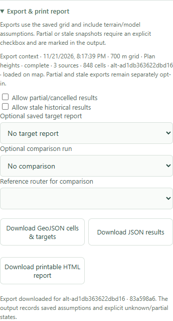

## Terrain and coordinates

The map and coordinate fields use WGS84. Input fields take latitude followed
by longitude. GeoJSON takes longitude followed by latitude. RF distances,
profiles and grids are calculated in the terrain's projected coordinate
reference system (CRS). Upload georeferenced GeoTIFF tiles that use the same
supported projected CRS and metre units.

- **DTM** normally represents bare earth. It is the default diffraction surface.
  The model places an antenna at ground elevation plus its configured height
  and uses ground terrain to score candidate sites.
- **DOM** is surface elevation and can include trees and buildings. Where
  available, the model can subtract DTM from DOM around a site to estimate
  terminal clutter when enabled. DOM supplies diffraction obstacles only when
  you choose **Surface with trees and buildings (DOM)**.
- A missing or masked ground sample is unknown. It cannot certify a link or
  coverage cell. A raster's outline shows its footprint. It can contain
  no-data gaps.

The **Terrain coverage** layer shows loaded ground and surface outlines and
highlights sampled gaps. The planner splits downloads into tiles, reprojects
source elevations to the project's projected CRS, and validates the tiles
before activating them. New projects use a compatible provider CRS where
available, otherwise a local WGS84 UTM zone or polar projection. The requested
route resolution accepts 1–1,000 m. The source resolution can set a coarser
effective limit. Supplemental coverage downloads start at 25 m and can
coarsen to the pixel budget. Basemaps and online terrain downloads require a
network connection. Uploaded terrain and RF calculation work locally.

To try the workflow with synthetic terrain, upload the [two-ridges GeoTIFF](../examples/synthetic_two_ridges.tif)
as ground terrain in a new project. Set **Start point** to **60.344700, 10.499586**
and **Destination** to **60.344700, 10.654851**. Under **Advanced search limits**,
set the corridor half-width to 1,200 m, candidate spacing to 250 m and maximum
hop length to 5,500 m. Choose **Quick · fewer candidate sites**, then
**Find repeater route**. The elevations in this sample are synthetic. They are
for practicing the workflow.

## Data sources

Open **⋯ → Data sources…** to manage the registry for all projects on the
server. Built-in terrain providers include Kartverket NHM (1 m ground and
surface elevation in mainland Norway), USGS 3DEP (10 m ground elevation in
covered areas of the United States), and Copernicus GLO-30 and GLO-90 (30 m and
90 m worldwide surface models). Built-in maps include OpenStreetMap,
OpenTopoMap, Esri Dark Gray (a dark map that makes the coverage heatmap
stand out), Kartverket topo and grey, and Sentinel-2 cloudless imagery.

Automatic selection works tile by tile. It prefers sources that cover the
tile centre, then finer native resolution, then higher priority. Other
eligible providers can fill missing pixels. Ground and surface downloads
select sources independently. Copernicus surface models can include trees
and buildings even when used for the ground input. Antenna elevations and
clearance predictions can differ from results calculated with bare-earth
elevation, especially in forests and built-up areas.

Use **Add source** for a WCS service, a single cloud-optimized GeoTIFF (COG),
a tiled COG collection, XYZ/WMTS map tiles, or a WMS map. Use **Test** on an
enabled terrain provider to check a small area around the map centre. Use
**Preview** on a map layer to display it briefly. You can disable built-in
sources and edit or remove custom ones. A plan that pins a disabled or removed
source needs a new selection before estimating terrain again.

The registry stores custom definitions in `providers.json` under the server's
data directory. Set `RF_PLANNER_PROVIDERS_FILE` to use another path. The version
1 file contains `disabled_builtins` (built-in IDs to disable), `terrain` and
`basemaps`. Each custom definition has a unique lowercase ID, name, kind and
attribution. Terrain definitions also specify coverage, native resolution and
one or both elevation products (`dtm` and `dom`). Coverage can be global, a
bounding box, multiple boxes or polygon rings in WGS84. Coordinates in boxes
are west, south, east, north. An optional `region` (for example `"Norway"`)
labels the coverage in the source list instead of its bounds. Match each
product's fields to its source kind.
See the [provider schema](design/DATA_SOURCES.md#provider-definition-file).

This example defines a regional WCS and a tiled COG collection. Replace the
example URLs, coverage and attribution with values from your providers.

```json
{
  "version": 1,
  "disabled_builtins": [],
  "terrain": [
    {
      "id": "regional-wcs",
      "name": "Regional ground model",
      "kind": "wcs",
      "coverage": {"type": "bbox", "bbox": [10, 59, 12, 61]},
      "resolution_m": 2,
      "attribution": "Example mapping agency",
      "products": {
        "dtm": {
          "endpoint": "https://elevation.example.org/wcs",
          "coverage": "ground",
          "version": "1.0.0",
          "native_crs": ["EPSG:25833"],
          "format": "GeoTIFF"
        }
      }
    },
    {
      "id": "regional-cog-tiles",
      "name": "Regional elevation tiles",
      "kind": "cog_tiles",
      "coverage": {"type": "bbox", "bbox": [10, 59, 12, 61]},
      "resolution_m": 10,
      "attribution": "Example elevation programme",
      "products": {
        "dtm": {
          "url_template": "https://tiles.example.org/dem/{NS}{lat2}{EW}{lon3}.tif",
          "tile_degrees": 1.0
        }
      }
    }
  ],
  "basemaps": []
}
```

Keep each provider's attribution with the data and check its licence before
sharing maps, elevations or derived products. The map displays attribution for
active layers. Terrain estimates list the planned sources and their credits.
Browser map requests go directly to the map provider. For terrain services
that require HTTP headers, use server environment references such as
`${TERRAIN_API_TOKEN}`. The editor displays stored literal values as `***`.

## Road filter

In **Search**, check **Only suggest sites near roads**. **Max distance to
road (m)** defaults to 1,000 m and accepts 10–20,000 m. **Road classes**
offers **Public roads** for mapped road classes from motorways through
residential and service roads, or **Public roads and tracks** to also include
mapped tracks. The latter is the default class selection. Distances are
straight-line distances to mapped geometry. The filter applies to generated
sites. Endpoints, existing repeaters and manually pinned sites can still
participate beyond it.

RepeaterNet fetches OpenStreetMap data from Overpass in 0.1° latitude by
0.2° longitude tiles, about 11 × 11 km at 60° N. It requests tiles within
reach of valid candidate points and can reuse the same tiles across projects
on the server. **Loading road network** shows progress. **Analysis** reports
how many candidate grid points passed the filter.

**Roads near repeaters** appears when the selected alternative has nearby road
geometry and is on by default. Switching alternatives updates the geometry.
A route-site popup reports **Nearest road** in metres if known. The map looks
up to 1.5 times the configured road distance around selected repeaters,
including fixed sites. Mapped proximity gives no assurance about legal access
or the terrain between the road and the site. Road data is available under the
Open Database License (ODbL). [© OpenStreetMap contributors](https://www.openstreetmap.org/copyright).

## Keyboard shortcuts

| Key | Action |
| --- | --- |
| Tab / Shift+Tab | Move forward or backward between controls. |
| Enter / Space | Activate a focused button, disclosure, route alternative or link row as appropriate. |
| Left / Right arrow, Home / End | Switch between the desktop **Map** and **Analysis** tabs when the tab strip has focus. |
| Esc | Close a dialog, project menu or map popup, or exit a map placement, drawing or inspection mode. |
| Ctrl+Z / Cmd+Z | Undo a plan edit. |
| Ctrl+Shift+Z / Cmd+Shift+Z, or Ctrl+Y | Redo a plan edit. |

Plan shortcuts are inactive while a text field, select or dialog owns focus.
The map's **Undo** and **Redo** buttons use the same current-project history.
This history is separate from **Recover previous save**.

## Mobile layout

At widths up to 650 px, the destination bar switches between **Setup**, **Map**
and **Analysis**. **Setup** contains **1 Route**, **2 Coverage** and
**3 Scenarios**. Choose **Map** to place sites or review layers and **Analysis**
to read the result. Placement and inspection actions can switch destinations
for you. Use the bar to return to setup after reading the map or analysis.

| Setup | Map | Analysis |
| --- | --- | --- |
| 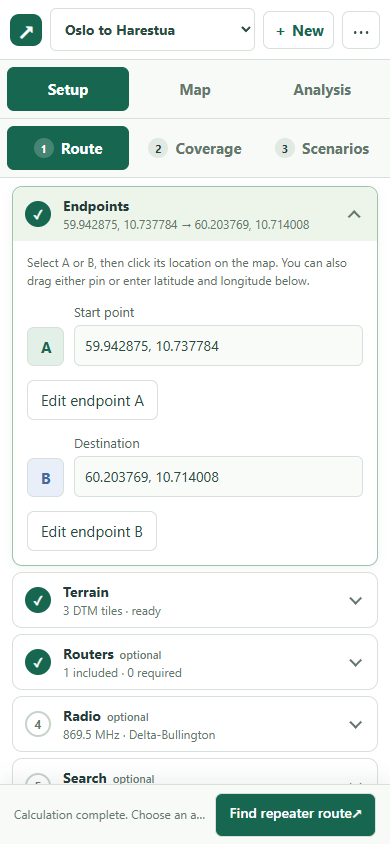 |  | 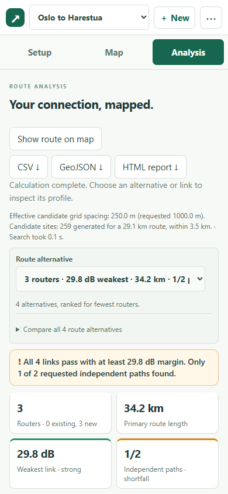 |

## Interpreting RF results

Route search and saved coverage combine free-space loss, antenna gains and feed
losses, Earth curvature, Fresnel clearance, terrain diffraction and receiver
sensitivity. Delta-Bullington over bare-earth terrain is the default. The model
correction accounts for measured optimism in the link budget. An optional
terminal clutter correction estimates the effect of nearby buildings or trees
using the difference between the surface and ground elevations around a site.
The directional budgets in **Analysis** show the diffraction model, model
correction, terminal clutter and sampling allowance for both directions.
Saved coverage applies a sampling allowance for profiles sampled more
coarsely than the native terrain. Both directions must pass to certify a hop.
Deygout can be used for route search. Live coverage falls back to
Delta-Bullington and reports the change in its status.

~~~text
FSPL = 32.44 + 20 log10(distance_km) + 20 log10(frequency_MHz)
received power = TX power + TX gain - TX feed loss
                 - FSPL - diffraction - clutter
                 - model correction - terminal clutter - terrain sampling allowance
                 + RX gain - RX feed loss - miscellaneous loss
usable margin = received power - receiver sensitivity - required fade margin
~~~

**Pass** means the link meets **Link validation** in both directions. A
geometrically obstructed link can pass **RF propagation + diffraction** if
its budget still closes. **Strict line of sight + Fresnel** also requires clear
line of sight and the configured Fresnel zone clearance. The first Fresnel
zone is the region around the direct radio path where obstacles affect the
signal. The Earth k-factor scales the radius used to calculate curvature.
The default uses the mean Earth radius.

| Usable margin | Interpretation |
| --- | --- |
| ≥ 10 dB | Strong, green. |
| 5 to < 10 dB | Good, light green. |
| 0 to < 5 dB | Marginal, amber. |
| < 0 dB, or a failed validation check | Fails, red and dashed on the route map. |
| Previous inputs | Stale, grey and dashed on the route map. |

Use the numbers and the validation result with the map colors. Compare the
weakest direction on each hop, the weakest hop across the whole network and
the independent-path count. Margin bands describe the modeled reserve after
the configured fade margin. At an unmeasured site, signal strength often differs
from the budget by about ±15.0 dB in the initial calibration. The configured
fade margin is a reserve for changes over time, where the calibration found a
typical standard deviation of about 2.5 dB. Analysis shows the prediction
spread separately, since site uncertainty depends on factors such as local
obstacles and antenna placement.

## Limitations

- The dashboard plans between two endpoints. The search is bounded and can
  use heuristics, so route quality depends on the area, candidate spacing,
  equipment assumptions and search limits. It cannot establish global
  optimality across the landscape.
- Sampled profiles can miss obstacles between samples. Surface data may omit
  buildings, new growth or recent changes. The model does not represent full
  terrain and climate propagation or measure interference or packet delivery.
- **Minimum infrastructure cost** is a proxy for installations and mast
  heights. Access, ownership and actual construction costs require separate
  checks. Test predicted routes and marginal handheld locations in the field.

## Troubleshooting

| What you see | What to check |
| --- | --- |
| The server opens a sign-in form | Use the token supplied by your server operator in **Access token**. If it is rejected, verify the server address and token. |
| Project list looks different | Reopen the original browser profile on the same server address. Look in **Archived projects** if the project was archived. |
| Saving fails or a project switch is blocked | Correct highlighted fields, restore the connection and choose **Retry save** if shown. If the browser suggests nearby values, use one of those values before switching. |
| Terrain estimate or download fails | Check the coordinates, corridor width, resolution, server disk space and connectivity. Try a coarser estimate or add compatible local ground tiles. |
| A selected site has missing ground elevation | Check **Terrain coverage**. Extend the ground tiles or move the site to terrain with valid elevation. |
| MeshCore lookup fails or returns few routers | Check provider connectivity and corridor width. Refresh the feed, work with saved routers or add a proposed site manually. |
| The road-filtered search fails | Check Overpass connectivity and the error in the job card. You can turn off **Only suggest sites near roads** to search without the road constraint. |
| No certified route or too few independent paths | Review required or excluded sites, terrain, hop limit, antenna assumptions, corridor width and effort. Changing these settings starts a different search when you choose **Find repeater route** again. |
| Coverage has no selectable sources | For a direct route, enable **Include endpoints as sources**. After a route edit, certify the route and then recalculate coverage. |
| Coverage has unknown or unresolved samples | Review the terrain status. Download additional coverage terrain for gaps. For unresolved profiles, review **Profile step · m** and **Maximum profile samples**. |
| Selected run cannot be inspected | Load the run with **Show saved run on map** before using **Inspect a map location**. |
| A comparison or target assessment is disabled | Read the compatibility message and check the selected run. Comparisons need compatible runs and a shared reference. Assessment needs saved targets and a completed current run. |
| Export is unavailable | For a stale route, run a new search. For historical coverage, select the saved run and review the partial and stale export options. |
| Basemap is blank | Check the connection or try the other basemap. Local plan and result layers can still appear without basemap tiles. |
