# RepeaterNet user guide

RepeaterNet plans terrain-aware radio links between two locations and estimates
where a handheld could use the resulting mesh. **1 Route** sets up the link,
**2 Coverage** predicts handheld access, and **3 Scenarios** tests changes and
assesses places you care about. Use **Map** to edit the plan and **Analysis** to
read the result. The examples use a roughly 29 km route across Nordmarka, from
Oslo to Harestua. A certified route meets the configured model checks. Verify
critical links in the field before choosing installation sites.

## Contents

- [Installation and launch](#installation-and-launch)
- [Projects and saving](#projects-and-saving)
- [Route setup](#route-setup)
- [Editing on the map](#editing-on-the-map)
- [Running a search and managing jobs](#running-a-search-and-managing-jobs)
- [Reading Analysis](#reading-analysis)
- [Route exports](#route-exports)
- [Coverage](#coverage)
- [Location inspection](#location-inspection)
- [Scenarios and targets](#scenarios-and-targets)
- [Coverage exports and reports](#coverage-exports-and-reports)
- [Terrain and coordinates](#terrain-and-coordinates)
- [Road filter](#road-filter)
- [Keyboard shortcuts](#keyboard-shortcuts)
- [Mobile layout](#mobile-layout)
- [Interpreting RF results](#interpreting-rf-results)
- [Limitations](#limitations)
- [Troubleshooting](#troubleshooting)

## Installation and launch

Follow the [installation and launch instructions](../README.md) for your
platform. By default the server listens at **http://127.0.0.1:8000/**. If the
browser does not open, use the address printed by the server. If the operator
configured an access token, enter it in **Access token** and choose **Sign in**.
The token protects server access. The browser's workspace cookie identifies
your projects separately.

## Projects and saving

Choose a project in the top bar or use **＋ New**, give it a **Project name**
and choose **Create**. A new project starts with example coordinates near Oslo.
Plan edits save automatically. The top bar shows saving or saved status, with
workspace storage usage when available. If saving fails, correct any invalid
fields or restore the connection, then choose **Retry save**.

Open **⋯** for project actions.

| Control | What it does |
| --- | --- |
| **Rename…** | Changes the current project's display name. |
| **Duplicate** | Opens a copy with the current saved plan and terrain. Calculations can be run separately in the copy. |
| **Recover previous save** | Restores the previous saved plan revision and makes the current revision the recovery copy. This appears when a previous revision exists. |
| **Export plan file** | Downloads a portable `route.webplan.json` with settings, sites, policies and targets. Terrain and computed results are separate. |
| **Import plan file…** | Opens the plan JSON and autosaves its settings and sites in the current project. Import into a new project to keep both plans. Load matching terrain as needed. |
| **Archive** | Removes the project from the active list and keeps its saved data. The dashboard switches to another project or creates a replacement. |
| **Archived projects** → **Restore** | Returns an archived project to the active list and opens it. |
| **Delete permanently…** | Deletes the selected project's stored data after confirmation. |
| **Clear saved RF calculations** | Clears cached link calculations for this workspace. Later RF searches may have more work to do. Kartverket and Overpass downloads have their own shared caches. |

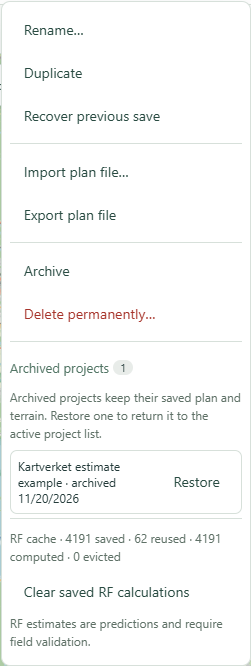

Projects and saved coverage runs live on the server. The browser's workspace
cookie lets it reopen the same project list. Another browser profile or a cleared
cookie can open a different workspace. The dashboard has no user accounts or
cross-browser project-sharing controls. A compact route summary survives a server
restart. Rerun the saved plan to rebuild full route profiles and restore the
certified route for current analysis. Saved coverage runs can be opened separately.

## Route setup

In **1 Route**, open each step by its heading. The collapsed summaries show what
you set. The readiness card offers **Review endpoints**, **Open terrain setup**
or **Review terrain gaps** when it needs your attention. For a first search,
**Endpoints** and ground **Terrain** are enough to get started.

### Endpoints

Enter WGS84 latitude and longitude, separated by a comma, in **Start point** (A)
and **Destination** (B). You can also use **A** or **B** in the step, **Set A**
or **Set B** on the map, or drag either pin. Check where both pins landed.

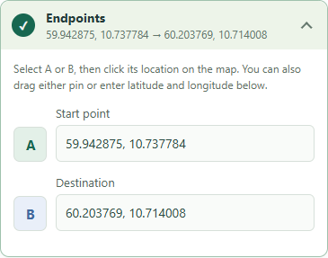

### Terrain

For a route in Norway, choose **Estimate Kartverket terrain**. Review the planned
tile count, effective resolution, estimated uncompressed disk usage, free space
and cache hits. Choose **Download planned terrain** to prepare the tiles.
If you start with **Find repeater route** and ground tiles are missing, review the
combined estimate dialog and choose **Download and find route**.

Under **Download options**, **Requested resolution · m** defaults to 10 m.
**Coarsen automatically to stay within the pixel budget** allows larger pixels
when needed. **Also download surface terrain** is enabled in a new project.
Disable it for a ground-only estimate. Adding surface terrain doubles the planned
product tile and pixel counts for the same area and resolution. File size varies.

Expand **Upload your own terrain files** to use local GeoTIFFs. **＋ Add ground
terrain** accepts bare-earth DTM tiles. **＋ Add surface terrain** accepts optional
DOM tiles for mapped surface obstacles. Each tile can be up to 512 MiB. Use
**Clear** beside the corresponding set to remove its workspace copy. Check the
confirmation for any additional coverage terrain that will also be cleared.
See [terrain and coordinates](#terrain-and-coordinates) for the file and map details.

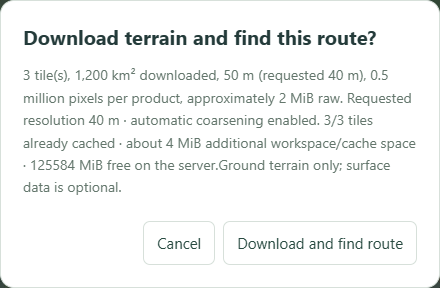

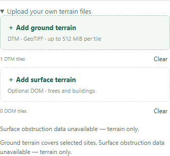

### Routers

Use **Find nearby MeshCore routers** to refresh the CoreScope catalog for the
current corridor. New feed entries start **Excluded**. Refreshing preserves saved
policies and marks entries missing from the latest feed as stale. The list shows
activity, last heard and distance from the route where available. Missing antenna
data uses your repeater assumptions. Feed activity is evidence of reported use.
The RF search still evaluates each link. **Help: existing and proposed routers**
explains what the feed and saved entries mean.

- Narrow the list with **Find by name or ID**, **Activity** or **Search policy**.
  **Activity** offers **Any activity**, **Relay active**, **Heard within 7 days**
  and **Active and heard within 7 days**. **Search policy** offers **Any policy**,
  **Optional**, **Required** and **Excluded**.
- Set a policy in each row. **Optional** allows the site to compete, **Required**
  includes it in the search constraints, and **Excluded** takes it out of the
  search while keeping the entry. **Show** centers the map on the router.
- **Mark … matches optional** and **Exclude … included matches** act on the
  matching set across the whole filtered list, including rows below the scroll.
  The count next to the buttons describes the scope.

For a site you want to try, use **Place proposed router on map** or expand
**Add a proposed router by coordinates**. Enter **Latitude**, **Longitude** and
**Antenna height · m**, then choose **Add router at coordinates**. A site placed
on the map starts at the configured repeater height. The coordinate form starts
at 10 m and accepts 0.1–1,000 m. Proposed sites start **Optional**. Use the site
row or marker to change **Antenna height · m** or **Use in search**. To move
it from the list, edit **Latitude** and **Longitude**, then choose **Apply
coordinates**. **Show on map** centers the map on the site. **Remove** removes
it from the plan. **Help: proposed routers** explains how to pin a route site.

### Radio

Set **Frequency · MHz** for your radios. Under **Transmitter and receiver
specifications**, enter **TX power · dBm**, **Sensitivity · dBm** and **Fade
margin · dB**. Choose **RF propagation + diffraction** or **Strict line of sight
+ Fresnel** in **Link validation**. Under **Antenna & propagation assumptions**,
set **Height AGL · m**, **Gain · dBi** and **Feed loss · dB** for **Endpoint A**,
**Endpoint B** and **Repeaters**. Set **Earth k-factor**, **Fresnel clearance
fraction · 0–1** and **Miscellaneous loss · dB** for the model. AGL is height above
ground level.

The starter profile uses 869.5 MHz, 22 dBm transmit power, −130 dBm sensitivity,
a 10 dB fade margin and 0 dB miscellaneous loss. All three antenna defaults are
3 m AGL, 2.15 dBi gain and 1 dB feed loss. Default validation uses propagation
and diffraction, k = 1.0 and 60% Fresnel clearance. See
[interpreting RF results](#interpreting-rf-results) for how these settings are used.

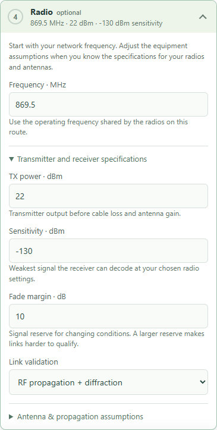

### Search

**Which sites can the route use?** offers **Use existing + proposed**, **Existing
only** and **Proposed only**. The default allows both kinds. Choose a **Route
objective** for how feasible alternatives are ranked.

| Objective | What it prioritizes |
| --- | --- |
| **Fewest total routers** | The smallest total router count. This is the default. |
| **Fewest new installations** | Use of existing infrastructure to reduce the number of new sites. |
| **Minimum infrastructure cost** | A planning proxy based on installations and mast heights. |
| **Maximum reliability** | Independent paths, then RF quality among equally redundant options. It can favor extra routers. |

**Search effort** defaults to **Balanced · up to 800 candidate sites**, with an
additional cap of 12 neighbors per site. **Quick · up to 200 candidate sites**
caps neighbors at 8. Both respect lower configured limits. **Thorough ·
configured candidate limit** uses the configured candidate and neighbor limits.
Smaller searches can miss viable or stronger alternatives. **Help: search effort**
summarizes the trade-off. **Only suggest sites near roads** adds the optional
[road filter](#road-filter).

Open **Advanced search limits** to adjust the search area, candidate density or
final terrain sampling. The configured defaults below are before the effort
caps.

| Control | Default and effect |
| --- | --- |
| **Corridor half-width · m (each side and around endpoints)** | 15,000 m. The 30 km wide, square-ended band extends 15 km past A and B. It guides generated candidates, route terrain downloads and the nearby MeshCore lookup. |
| **Candidate grid spacing · m** | 1,000 m between candidate grid points. Smaller spacing explores more possible locations. |
| **Maximum candidate sites** | 800. |
| **Maximum total routers** | 6 intermediate routers. |
| **Neighbors per site** | 16 before the effort cap. |
| **Maximum hop length · m (blank = auto)** | 50,000 m. Clearing the value removes the explicit distance cap. |
| **Refinement radius · m** and **Refinement step · m** | 250 m around a candidate, with positions sampled every 50 m. |
| **Final terrain sample step · m** | 10 m between samples on final route links. The earlier screening stages default to 200 m and 50 m. |

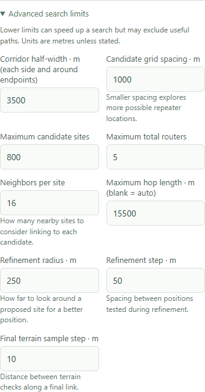

## Editing on the map

Use **Set A**, **Set B** or **Add router**, then click the map. The mode stays
visible in the toolbar while it expects a click. **Cancel** or Esc returns to
browsing. Right-click a position for **Set start (A) here**, **Set destination
(B) here**, **Add proposed router here** or **Copy coordinates**. Copied
coordinates use latitude, longitude to six decimals.

- Drag either endpoint or a manual router to move it. Open a manual router's
  popup to change antenna height or policy, or use **Remove**.
- Open a MeshCore router marker to read its ID and activity and choose **Excluded**,
  **Optional** or **Required**.
- Open a route-site marker to see its height, origin, distance to road when
  available, and **Links and margins**. Select a link in the popup to open its
  profile in **Analysis**. **Edit manual router** or **Edit MeshCore router**, when
  shown, opens the editable site. Drag a proposed route-site marker to pin that
  location as a **Required** proposed router. Run a fresh search after moving it.
- **Fit all** frames the plan sites and current route. **Undo** and **Redo** step
  through recent plan edits. **Candidates** shows generated sites from the search.
  **Roads near repeaters** toggles the selected alternative's nearby road geometry
  when available.
- Use **+** and **−** to zoom. In the layer control, choose **OpenStreetMap** or
  **Kartverket topo**. Toggle **Terrain coverage**, **Predicted mesh coverage**,
  **Coverage analysis area**, **Coverage difference** or **Coverage targets** as
  needed. **Map legend** explains the route lines and marker shapes.

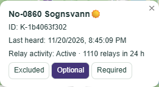

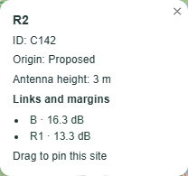

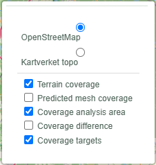

## Running a search and managing jobs

Choose **Find repeater route**. If ground terrain is ready, the search starts
after checking the plan. The engine generates and screens candidates, searches
for routes, and validates selected links at the final sampling step. A required
site needs valid ground elevation. If terrain is missing, review the readiness
message and the [terrain options](#terrain).

The job card shows the phase, elapsed time and progress when available. While it
runs, the inputs for that calculation are locked. **Cancel optimization** stops
the search. Use **Stop and keep this route** once a certified result is available
to retain the best result found so far. Its independent-path count can fall
short of the goal and the result records that the search stopped early.
**Cancel terrain preparation** stops a route terrain job and preserves previously
installed terrain. **Reconnect to job** resumes status checks if the connection
drops. When offered, **View results** opens **Analysis**. Use **Dismiss** (×) to
close the finished notice.

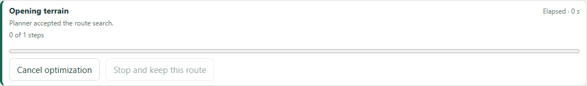

Edits to endpoints, radio, terrain, sites or search settings can make the route
stale. **Analysis** shows a stale badge and an explanation, and the old link lines
turn grey and dashed. Run **Find repeater route** again to validate the new inputs
and restore route export. Coverage must also be recalculated for the new route.

## Reading Analysis

Read the verdict and key figures first. The tiles show router count, primary path
length, weakest link and independent paths. Under **Route alternative**, choose
a different certified solution or open **Compare all … route alternatives** and
select a row. The engine returns feasible alternatives for exact router counts
within the search. Switching alternatives reuses evaluated results and updates
the map. **Show route on map** takes you to the current route.

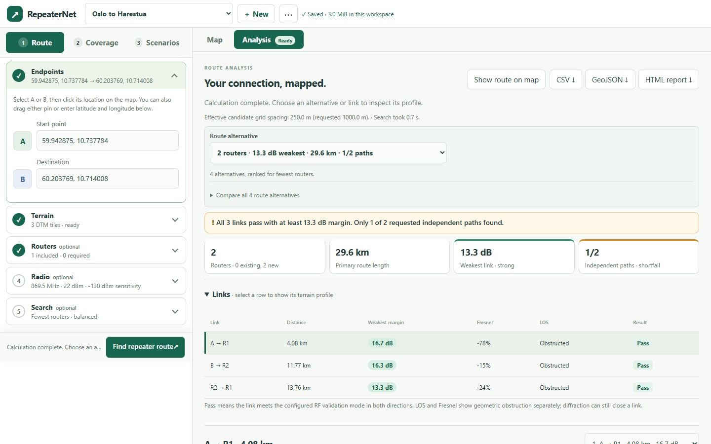

The comparison shows existing and proposed counts, primary length, weakest
margin across the network, weakest margin on the primary path, LOS-blocked hops
and achieved versus requested independent paths. Independent paths share no
intermediate router. A backup with a small margin can be the network bottleneck
even when the primary route has margin to spare. The default path target is two.

In **Links**, select a row or use the link picker above the chart. The table shows
**Distance**, **Weakest margin**, **Fresnel**, **LOS** and **Result**. The chart
shows ground with curvature, the surface when available, line of sight and the
required Fresnel boundary. Read the profile summary for the limiting points.
Expand **Forward and reverse link budget** for directional power, path loss,
received level, sensitivity and usable margin. **Detailed radio budget and
assumptions** shows the individual terms and model settings.

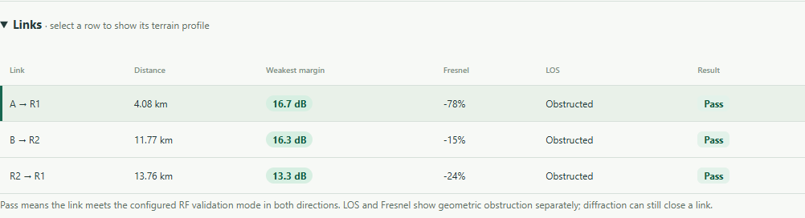

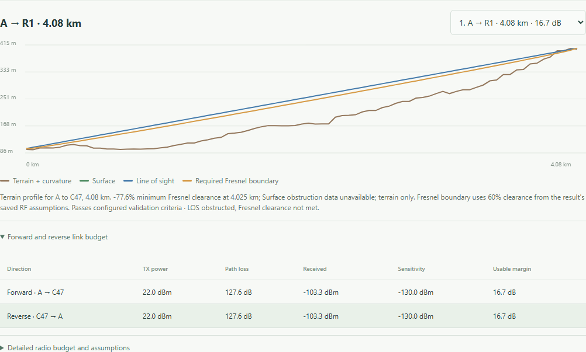

## Route exports

Use **CSV ↓**, **GeoJSON ↓** or **HTML report ↓** in **Analysis** to export the
selected certified route. CSV provides tabular results and GeoJSON provides map
features. The printable HTML report bundles a route map, site details, profiles
and directional budgets. The route and coverage layers in the report work
offline. Loading its OpenStreetMap background requires internet access.

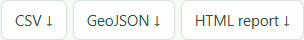

The HTML report includes the latest completed coverage run when it
matches the selected route, terrain and coverage settings and has no unresolved
or unevaluated cells. The report explains an omission. Coverage counts use the
full grid. The map includes a size-limited layer preview that can be toggled.
For an explicit saved run or historical coverage, use
[coverage exports](#coverage-exports-and-reports).

## Coverage

After certifying and selecting a route, open **2 Coverage**. The model evaluates
router-to-handheld and handheld-to-router separately for the selected mesh.
If the panel asks for a route, **Open route setup** takes you back to the
prerequisite. **Help: predicted coverage** explains what the model predicts.

### Area and detail

In **Area & detail**, set **Area**.

| Area | Samples |
| --- | --- |
| **Around the selected route** | The route search corridor, with full width continuing one half-width past A and B, plus the mesh buffer around repeaters and endpoints/clients. |
| **Area visible on the map** | The current map extent. Moving the map can invalidate a pending estimate. |
| **Draw a custom boundary** | Use **Draw area on map**, click at least three vertices and choose **Finish polygon**. Use **Cancel drawing**, **Cancel** or Esc to leave placement mode. **Clear drawn area** removes the saved boundary and returns to the route area. |

In **Advanced sampling and limits**, **Cell spacing · m** defaults to 1,000 m
(100–100,000 m), **Mesh buffer · m** to 5,000 m (0–100,000 m), **Profile step · m**
to 200 m (10–10,000 m) and **Maximum profile samples** to 4,096 (3–16,384).
Cell spacing controls map detail. Profile step controls the distance between
terrain samples along each RF path. If a profile hits the sample cap, it remains
unresolved. A larger step or higher cap can let it complete. **Help: profile
sample limit** explains this behavior.

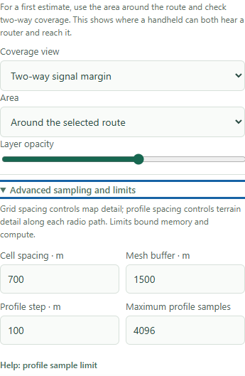

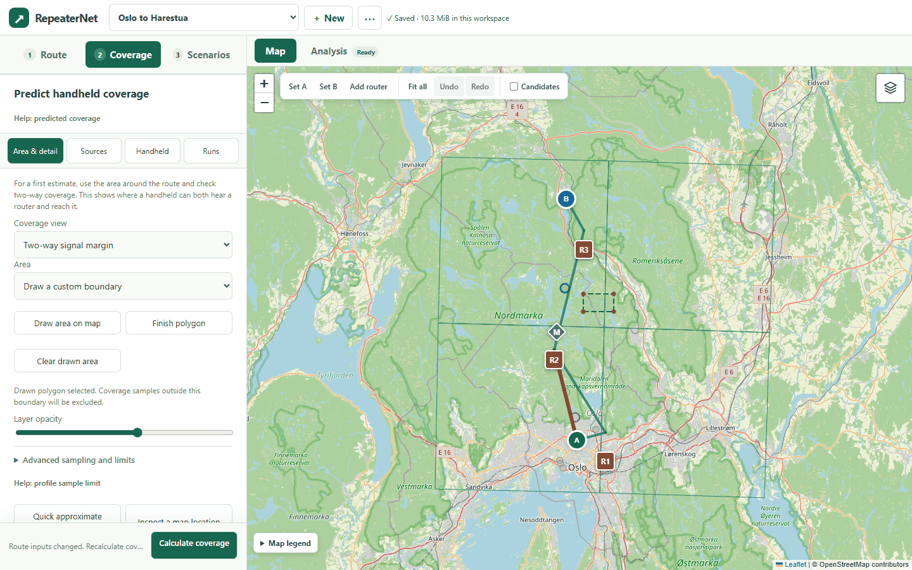

### Sources and handheld

Under **Sources**, select the **Router sources** to evaluate. The default uses
every repeater on the selected route. **Include endpoints as sources** also
evaluates A and B. Turn it on for a direct route without repeaters.

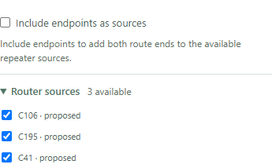

Under **Handheld**, use **Handheld radio assumptions** to set **Height AGL · m**,
**Transmit power · dBm**, **Antenna gain · dBi**, **Feed loss · dB**, **Sensitivity
· dBm** and **Other losses · dB**. The example client uses 1.5 m AGL, 20 dBm,
2.15 dBi, −130 dBm sensitivity and 0 dB feed and other losses. The handheld
profile is separate from the route's radio assumptions.

### Preview, calculate and read the map

1. Choose **Quick approximate preview** and review the estimate, then choose
   **Run preview**. The preview uses at most 256 cells and 4,096 source
   evaluations. Its approximate cells appear on the map. A preview cannot be
   selected as a saved run.
2. Choose **Calculate coverage**, review the work estimate and confirm with
   **Calculate coverage**. A standard run defaults to a 4,096-cell budget,
   with hard limits of 16,384 cells, 64 sources and 250,000 cell/source
   evaluations. The estimate reports effective spacing after coarsening,
   planned evaluations, known and unknown terrain, and the profile limits.
3. Cells stream onto the map. Use **Cancel coverage** to stop the job.
   Available partial cells can be retained. **Reconnect to coverage run**
   resumes status checks and cell loading after a lost connection.

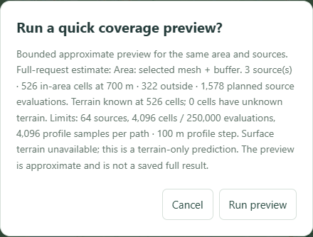

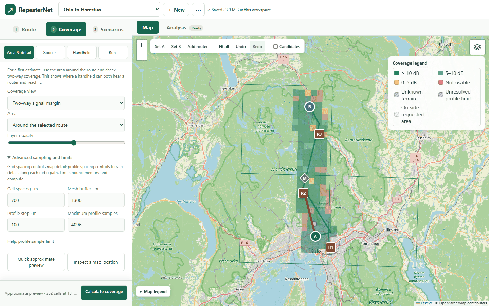

**Coverage view** changes how the existing samples are drawn. **Two-way signal
margin** needs both directions for a source. **Router → handheld** shows
downlink and **Handheld → router** shows uplink. **Overlapping routers** counts
usable links to multiple sources. It measures local options and does not
measure independent backbone paths. **Best serving router** colors cells by
the source with the best valid two-way margin. If the list is long, use
**Filter serving routers** in the legend. Adjust **Layer opacity**, or toggle
**Predicted mesh coverage** in the map layers control.

Read the **Coverage legend** with the map and hover over a cell for its summary.
**Not usable**, **Unknown terrain**, **Unresolved profile limit**, and
**Outside requested area** represent different outcomes. Unevaluated work in a
partial run is also separate. For an individual place, use location inspection.

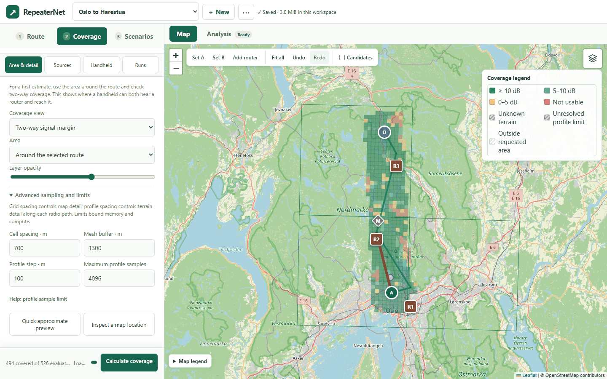

### Additional terrain and saved runs

If the coverage area extends beyond installed terrain, or unknown cells are
reported, choose **Download terrain for coverage area**. Review the missing
area, tile count, resolution, approximate size and cache reuse. When route DOM
is present, the supplemental download includes surface terrain. Use **Cancel
coverage terrain download** or **Reconnect to terrain download** as needed.
When the tiles are ready, choose **Calculate coverage** again.

Coverage uses the first valid sample from route terrain, then supplemental tiles.
A coverage download preserves the certified route and its original terrain.
Supplemental tiles remain installed when the coverage area or route alternative
changes. Clearing, uploading or preparing route terrain resets the supplemental
set. Previously downloaded Kartverket tiles can be reused. Paths outside the
tiles and no-data pixels can still produce unknown results.

In **Runs**, **Analysis context** identifies the selected mesh and client
assumptions. Select a **Saved coverage run** to use for inspection, targets and
exports. **Show saved run on map** loads its cells incrementally without new RF
work. The run label includes the time, grid, height overrides and state.
An identical completed run can be reused when route, terrain, sources, grid,
radio and model metadata match. Otherwise, calculate again. A stored result is
limited to 100 MiB. A result larger than the limit fails to save.

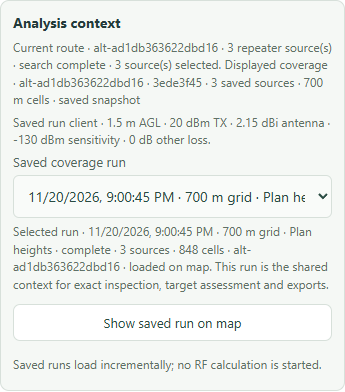

## Location inspection

For a saved run, select it in **Runs** and choose **Show saved run on map** first.
Choose **Inspect a map location**, then click the location. You can also inspect
with the current route and coverage settings before saving a run. The exact
point is evaluated using the relevant client assumptions and source heights.
A grid cell nearby represents a different sample.

**Analysis** opens the inspection result. Read the best source, distance,
directional margins, two-way status and mesh component. The details list the
other candidate links and their rejection reasons. Open **Profile legend** to
interpret the terrain and Fresnel chart. The result states when the location is
outside the requested area, terrain is missing or the sample limit prevented an
evaluation. **Show location on map** returns to the marker. **Stop inspecting
locations** or **Cancel** exits inspection mode.

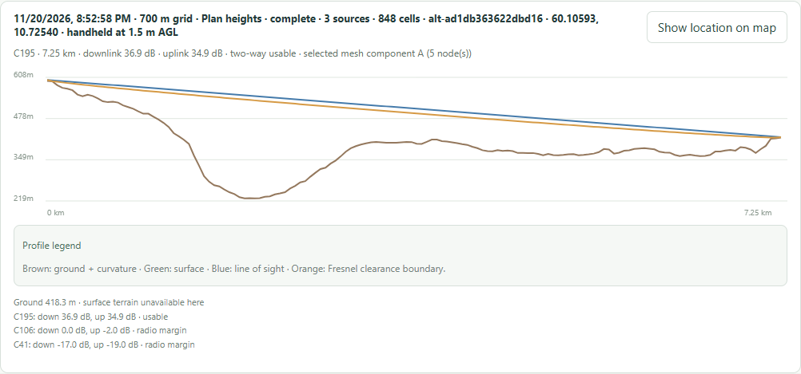

## Scenarios and targets

Use **3 Scenarios** to ask what changes on a calculated network. Saved runs are
snapshots. **Open coverage** takes you to coverage setup if a run is needed.

### Router failure

Open **Router failure scenario**. In **2 Coverage** → **Runs**, select a
completed, current run with a repeater source. Back in **3 Scenarios**, pick a
**Reference router**, check one or more **Disable …** boxes and choose
**Analyze failures**. The result reports surviving components and cells that
lost local access or a connection to the reference. A handheld can still
reach a surviving router in a disconnected component. Keep the reference
enabled to measure connectivity to that router. **Reset scenario** clears
the failure selection. Analyze again to see the baseline.

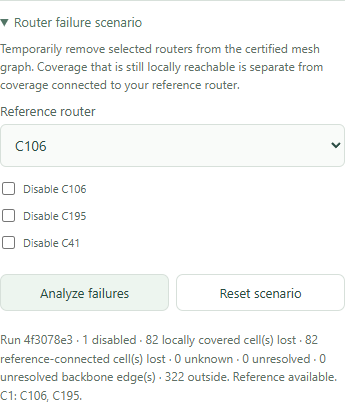

### Antenna heights and run comparison

Open **Antenna heights & run comparison**. Enter trial heights for the selected
route's repeater sources or choose **Set all to 3 m**, **Set all to 6 m** or
**Set all to 10 m**. Height scenarios accept 0.1–500 m AGL. Change at least one
height, then choose **Calculate height scenario** and approve the coverage
estimate. The run is saved separately. Affected certified backbone links are
revalidated at the trial heights. The scenario uses the existing mesh graph.

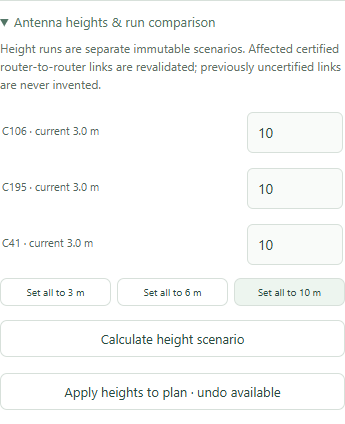

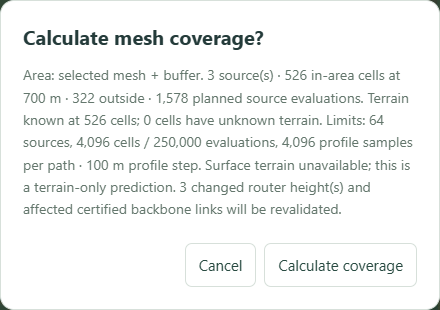

Use **Baseline run**, **Scenario run** and a shared **Reference router**.
The dashboard explains incompatible selections. Compare completed runs using
compatible project, terrain, model, radio, client and grid assumptions. Choose
**Compare runs on map** to see **Coverage difference** for reference-connected
coverage. The summary also reports local gains and losses, retained coverage,
unknown cells and unresolved profiles. Use the difference legend and map layer
control to distinguish changes from the underlying prediction.

**Apply heights to plan · undo available** saves the trial heights as plan edits.
Edited proposed sites become **Required**. Run a new route search and calculate
coverage again after applying. Use **Undo** if needed.

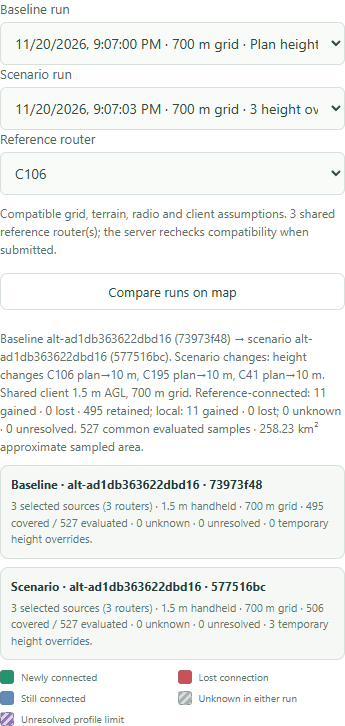

### Point, area and road targets

Open **Assess places, areas & roads**. Use **Place a point target on map**,
click the location, enter a name in **Name point target** and choose **Add
target**. Or expand **Add a point by coordinates** and enter **Latitude**,
**Longitude** and **Target name**, then select **Add target at coordinates**.

Use **＋ Import GeoJSON targets** for a WGS84 GeoJSON FeatureCollection of
points, lines and polygons, up to 5 MiB. Use longitude, latitude order. Imported
features can include a name, minimum margin and a reference router ID in
`properties`. The fields are `name`, `minimum_margin_db` and `reference_id`.
The default minimum margin is 0 dB. Set **Road sample spacing · m** for
imported lines. It defaults to 100 m and accepts 25–5,000 m.

In the list, use **Focus** to locate a target or **Remove** to delete it.
Point targets also offer **Edit**. Change **Name** or **Minimum margin · dB**
(−100 to 100 dB) and choose **Save target** or **Cancel**. An edit clears old
assessments for the changed target set.

Select a completed, current run in **Runs**, then choose **Assess targets
against selected run**. Points and roads use exact-position path calculations.
Areas use conservative saved-grid evaluation. An unknown, out-of-area or
unresolved sample cannot establish a pass, and areas with too few representative
cells can need finer sampling. Use **Focus target** to see an assessed target.

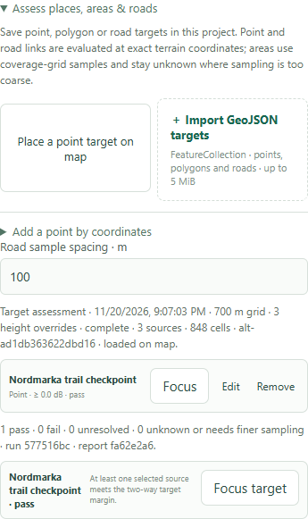

To compare target outcomes, assess the same targets on two compatible saved
runs. Open **Compare target outcomes across runs**, choose a **Baseline target
report** and **Scenario target report**, then choose **Compare target reports**.
Each row shows the change and the two outcomes.

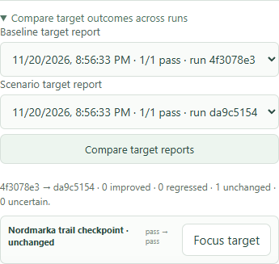

## Coverage exports and reports

In **2 Coverage** → **Runs**, select the **Saved coverage run** and open
**Export & print report**. The selected run is used even if a different run
is displayed on the map. Review the export context before downloading.

- **Download GeoJSON cells & targets** includes spatial cell and target
  geometry for mapping.
- **Download JSON results** includes the saved grid and run metadata.
- **Download printable HTML report** includes an offline SVG map and the
  run's RF, terrain and grid assumptions. Open the downloaded file in a
  browser to print it.
- **Optional saved target report** can include assessed targets. **Optional
  comparison run** and **Reference router for comparison** add a compatible
  comparison to JSON and HTML reports.
- **Allow partial/cancelled results** and **Allow stale historical results**
  are separate opt-ins. A completed run with unresolved or unevaluated cells
  also requires the partial opt-in. Enable the relevant permissions and
  review the markings in the exported file.

## Terrain and coordinates

The map and coordinate fields use WGS84. Input fields take latitude followed
by longitude. GeoJSON takes longitude followed by latitude. RF distances,
profiles and grids are calculated in the terrain's projected coordinate
reference system (CRS). Upload georeferenced GeoTIFF tiles that use the same
supported projected CRS and metre units.

- **DTM** is bare-earth elevation. The model places an antenna at ground
  elevation plus its configured height above ground, and uses ground terrain
  to score candidate sites.
- **DOM** is surface elevation and can include trees and buildings. Where
  surface samples are available, they inform the obstruction profile. With no
  surface data the model reports a terrain-only assumption.
- A missing or masked ground sample is unknown. It cannot certify a link or
  coverage cell. A raster's outline shows its footprint. It can contain
  no-data gaps.

The **Terrain coverage** layer shows loaded ground and surface outlines and
highlights sampled gaps. Kartverket's route estimate selects a configured
Norwegian ETRS89 UTM service for the planning coordinates. Larger areas are
split into tiles. Requested route resolution accepts 1–1,000 m. Supplemental
coverage downloads start at 25 m by default and can coarsen to the pixel
budget. Downloaded tiles are validated before they become active. Basemap
tiles and online providers require a network connection. Uploaded terrain
and RF calculation work locally. [Packaged Kartverket service definitions](../rust/crates/providers/src/kartverket_wcs.json).

To try the workflow with synthetic terrain, upload the [two-ridges GeoTIFF](../examples/synthetic_two_ridges.tif)
as ground terrain in a new project. Set **Start point** to **60.344700, 10.499586**
and **Destination** to **60.344700, 10.654851**. Under **Advanced search limits**,
set the corridor half-width to 1,200 m, candidate spacing to 250 m and maximum
hop length to 5,500 m. Choose **Quick · up to 200 candidate sites**, then
**Find repeater route**. The elevations in this sample are synthetic. They are
for practicing the workflow.

## Road filter

In **Search**, check **Only suggest sites near roads**. **Max distance to
road (m)** defaults to 1,000 m and accepts 10–20,000 m. **Road classes**
offers **Public roads** for mapped road classes from motorways through
residential and service roads, or **Public roads and tracks** to also include
mapped tracks. The latter is the default class selection. Distances are
straight-line distances to mapped geometry. The filter applies to generated
sites. Endpoints, existing repeaters and manually pinned sites can still
participate beyond it.

RepeaterNet fetches OpenStreetMap data from Overpass in 0.1° latitude by
0.2° longitude tiles, about 11 × 11 km at 60° N. It requests tiles within
reach of valid candidate points and can reuse the same tiles across projects
on the server. **Loading road network** shows progress. **Analysis** reports
how many candidate grid points passed the filter.

**Roads near repeaters** appears when the selected alternative has nearby road
geometry and is on by default. Switching alternatives updates the geometry.
A route-site popup reports **Nearest road** in metres if known. The map looks
up to 1.5 times the configured road distance around selected repeaters,
including fixed sites. Mapped proximity gives no assurance about legal access
or the terrain between the road and the site. Road data is available under the
Open Database License (ODbL). [© OpenStreetMap contributors](https://www.openstreetmap.org/copyright).

## Keyboard shortcuts

| Key | Action |
| --- | --- |
| Tab / Shift+Tab | Move forward or backward between controls. |
| Enter / Space | Activate a focused button, disclosure, route alternative or link row as appropriate. |
| Left / Right arrow, Home / End | Switch between the desktop **Map** and **Analysis** tabs when the tab strip has focus. |
| Esc | Close a dialog, project menu or map popup, or exit a map placement, drawing or inspection mode. |
| Ctrl+Z / Cmd+Z | Undo a plan edit. |
| Ctrl+Shift+Z / Cmd+Shift+Z, or Ctrl+Y | Redo a plan edit. |

Plan shortcuts are inactive while a text field, select or dialog owns focus.
The map's **Undo** and **Redo** buttons use the same current-project history.
This history is separate from **Recover previous save**.

## Mobile layout

At widths up to 650 px, the destination bar switches between **Setup**, **Map**
and **Analysis**. **Setup** contains **1 Route**, **2 Coverage** and
**3 Scenarios**. Choose **Map** to place sites or review layers and **Analysis**
to read the result. Placement and inspection actions can switch destinations
for you. Use the bar to return to setup after reading the map or analysis.

| Setup | Map | Analysis |
| --- | --- | --- |
|  | 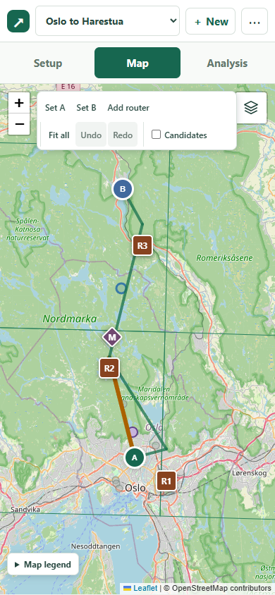 |  |

## Interpreting RF results

The model combines free-space loss, antenna gains and feed losses, effective
Earth curvature, Fresnel clearance, Bullington terrain diffraction, optional
configured clutter loss and receiver sensitivity. It calculates forward and
reverse budgets separately. Both directions must pass before a route edge can
be certified.

~~~text
FSPL = 32.44 + 20 log10(distance_km) + 20 log10(frequency_MHz)
received power = TX power + TX gain - TX feed loss
                 - FSPL - diffraction - clutter
                 + RX gain - RX feed loss - miscellaneous loss
usable margin = received power - receiver sensitivity - required fade margin
~~~

**Pass** means the link meets **Link validation** in both directions. A
geometrically obstructed link can pass **RF propagation + diffraction** if
its budget still closes. **Strict line of sight + Fresnel** also requires clear
line of sight and the configured Fresnel zone clearance. The first Fresnel
zone is the region around the direct radio path where obstacles affect the
signal. The Earth k-factor scales the radius used to calculate curvature.
The default of 1.0 uses the mean Earth radius, which models more curvature than
k = 4/3. The diffraction implementation uses the Bullington terrain component.
The full delta-Bullington and spherical-Earth terms are outside the model.

| Usable margin | Interpretation |
| --- | --- |
| ≥ 10 dB | Strong, green. |
| 5 to < 10 dB | Good, light green. |
| 0 to < 5 dB | Marginal, amber. |
| < 0 dB, or a failed validation check | Fails, red and dashed on the route map. |
| Previous inputs | Stale, grey and dashed on the route map. |

Use the numbers and the validation result with the map colors. Compare the
weakest direction on each hop, the weakest hop across the whole network and
the independent-path count. Margin bands describe the modeled reserve after
the configured fade margin.

## Limitations

- The dashboard plans between two endpoints. The search is bounded and can
  use heuristics, so route quality depends on the area, candidate spacing,
  equipment assumptions and search limits. It cannot establish global
  optimality across the landscape.
- Sampled profiles can miss obstacles between samples. Surface data may omit
  buildings, new growth or recent changes. The model does not represent full
  terrain and climate propagation or measure interference or packet delivery.
- **Minimum infrastructure cost** is a proxy for installations and mast
  heights. Access, ownership and actual construction costs require separate
  checks. Test predicted routes and marginal handheld locations in the field.

## Troubleshooting

| What you see | What to check |
| --- | --- |
| The server opens a sign-in form | Use the token supplied by your server operator in **Access token**. If it is rejected, verify the server address and token. |
| Project list looks different | Reopen the original browser profile on the same server address. Look in **Archived projects** if the project was archived. |
| Saving fails or a project switch is blocked | Correct highlighted fields, restore the connection and choose **Retry save** if shown. If the browser suggests nearby values, use one of those values before switching. |
| Terrain estimate or download fails | Check the coordinates, corridor width, resolution, server disk space and connectivity. Try a coarser estimate or add compatible local ground tiles. |
| A selected site has missing ground elevation | Check **Terrain coverage**. Extend the ground tiles or move the site to terrain with valid elevation. |
| MeshCore lookup fails or returns few routers | Check provider connectivity and corridor width. Refresh the feed, work with saved routers or add a proposed site manually. |
| The road-filtered search fails | Check Overpass connectivity and the error in the job card. You can turn off **Only suggest sites near roads** to search without the road constraint. |
| No certified route or too few independent paths | Review required or excluded sites, terrain, hop limit, antenna assumptions, corridor width and effort. Changing these settings starts a different search when you choose **Find repeater route** again. |
| Coverage has no selectable sources | For a direct route, enable **Include endpoints as sources**. After a route edit, certify the route and then recalculate coverage. |
| Coverage has unknown or unresolved samples | Review the terrain status. Download additional coverage terrain for gaps. For unresolved profiles, review **Profile step · m** and **Maximum profile samples**. |
| Selected run cannot be inspected | Load the run with **Show saved run on map** before using **Inspect a map location**. |
| A comparison or target assessment is disabled | Read the compatibility message and check the selected run. Comparisons need compatible runs and a shared reference. Assessment needs saved targets and a completed current run. |
| Export is unavailable | For a stale route, run a new search. For historical coverage, select the saved run and review the partial and stale export options. |
| Basemap is blank | Check the connection or try the other basemap. Local plan and result layers can still appear without basemap tiles. |
